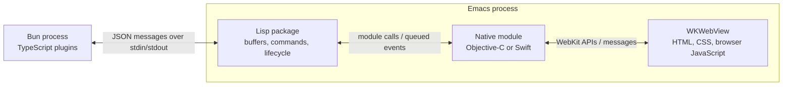

# Native views in Emacs: macOS WebKit and TypeScript plugins

Research date: 2026-09-16

## Summary

Rendering a native macOS webview inside an Emacs window is possible without maintaining an Emacs fork. Two existing implementations establish this:

- Upstream Emacs has a macOS xwidget backend built on Apple's `WKWebView`.
- [Appine](https://github.com/chaoswork/appine) embeds WebKit, PDFKit, and Quick Look views through an Emacs dynamic module.

The recommended approach is to test the experience with the existing xwidget implementation, then build a small native module with a Bun subprocess as the TypeScript plugin host if a more general framework is needed.

The native module would own macOS views. Lisp would own Emacs buffers, window integration, and process management. Bun would execute TypeScript plugins. Neither Python nor a listening server is inherently required for the control channel.

This document records source research and a local build-capability check. It does not report a completed graphical proof of concept or performance benchmarks.

## Goal and scope

Initial goal:

- Open a local HTML file, including JavaScript, as a rendered webview inside Emacs.
- Use the native macOS WebKit API.
- Keep setup and implementation small.

Longer-term direction:

- Host other native views through the same infrastructure.
- Allow plugins written in TypeScript, with an experience inspired by Raycast.
- Leave room for another web engine later.

Bundling Chromium is outside the initial scope. This research does not establish that Chromium would improve performance; that would require workload-specific measurement.

## Existing support in the installed Emacs

The local Emacs binary reported:

| Capability | Observed value |
| --- | --- |
| Version | 31.1 |
| Native macOS GUI | `NS` |
| Dynamic modules | `MODULES`; `module-load` available |
| Embedded widgets | `XWIDGETS`; `xwidget-internal` available |
| Relevant configure options | `--with-ns --with-xwidgets --with-modules` |

This was checked in a clean batch process. It establishes build support, not successful graphical rendering.

The following can be evaluated in graphical Emacs to try a local HTML file:

```elisp
(require 'xwidget)
(require 'browse-url)

(xwidget-webkit-browse-url
 (browse-url-file-url "/absolute/path/demo.html"))
```

Alternatively, run `M-x xwidget-webkit-browse-url` and enter a URL. JavaScript is enabled by default. Lisp can also call `xwidget-webkit-execute-script`, optionally supplying a callback for the JavaScript return value.

No rebuild should be necessary for this first experiment on the checked installation. Other Emacs installations need the appropriate build features enabled.

Sources:

- [Emacs embedded WebKit manual](https://www.gnu.org/software/emacs/manual/html_node/emacs/Embedded-WebKit-Widgets.html)
- [Emacs xwidget API](https://www.gnu.org/software/emacs/manual/html_node/elisp/Xwidgets.html)
- [Upstream macOS xwidget implementation](https://github.com/emacs-mirror/emacs/blob/master/src/nsxwidget.m)

## Existing projects

### Appine: the closest native implementation

[Appine](https://github.com/chaoswork/appine) uses a C/Objective-C dynamic module loaded into Emacs. It provides WebKit, PDFKit, and Quick Look backends.

Its native implementation attaches a container view to the Emacs macOS window's `contentView`. Lisp calculates the relevant Emacs window's rectangle and uses hooks to update geometry, visibility, and focus. This demonstrates native embedding without an Emacs source patch.

Appine is a useful reference, but its current design centres on one native container with its own tabs. Its Lisp code explicitly handles multiple windows showing the Appine buffer by attaching the native view only to the active presentation. A framework with independent plugin buffers would need to revisit that model.

Sources:

- [Native container and focus handling](https://github.com/chaoswork/appine/blob/master/src/core/appine_core.m)
- [Lisp geometry and lifecycle integration](https://github.com/chaoswork/appine/blob/master/appine.el)
- [Native backend interface](https://github.com/chaoswork/appine/blob/master/src/backends/appine_backend.h)

### EAF: external GUI process and RPC

[Emacs Application Framework](https://github.com/emacs-eaf/emacs-application-framework) runs a Python/Qt application. Emacs and Python communicate using EPC remote procedure calls. Its Python process creates a server on `127.0.0.1` and runs the server in a separate thread alongside Qt's event loop.

On macOS, EAF uses separate windows positioned over Emacs. Its source explicitly selects this approach because its cross-process window reparenting technique is unavailable there. Visibility and position are synchronized with Emacs.

Replacing Python with Bun would change the plugin/runtime language, but native rendering and window integration would still need an implementation.

Sources:

- [Python process and EPC server](https://github.com/emacs-eaf/emacs-application-framework/blob/master/eaf.py)
- [Platform-specific embedding selection](https://github.com/emacs-eaf/emacs-application-framework/blob/master/eaf.el)
- [Qt view positioning and reparenting](https://github.com/emacs-eaf/emacs-application-framework/blob/master/core/view.py)

## Options

The trade-offs here are engineering assessments based on the inspected implementations.

| Approach | Emacs source changes? | Advantages | Limitations |
| --- | --- | --- | --- |
| Build on xwidget-webkit | No; requires an enabled build | Fastest route to HTML/JS previews; existing Lisp API | Limited to functionality exposed by xwidgets |
| Adapt Appine | No; requires dynamic modules | Working native attachment and multiple viewer backends | Its single-container/tab model differs from independent plugin buffers |
| Small native module plus Bun | No | Control over lifecycle, messaging, and plugin API | Must implement geometry, focus, and compatibility handling |
| Separate native helper with overlay windows | No | UI process isolation | Coordination around movement, focus, Spaces, fullscreen, and stacking |
| Add a native-view API to Emacs core | Yes | Explicit integration with the display lifecycle | Upstream or patch maintenance; unnecessary for the initial milestone |

**Recommendation:** use xwidgets for the first experiment, then pursue a small native module plus Bun for the broader plugin platform. Evaluate Appine as an implementation reference or starting point.

## Proposed architecture

This is a design proposal, not an existing package API.



The diagram shows the components the bridge would own. WebKit manages its own supporting processes internally.

### Lisp responsibilities

- Create buffers and expose interactive commands.
- Track which windows display each buffer.
- Calculate presentation rectangles and update visibility.
- Start and supervise Bun.
- Route asynchronous messages.
- Dispose of views and pending requests when buffers or frames disappear.

A buffer is an Emacs document; an Emacs window is an area displaying that document. A single buffer can appear in multiple windows. For the first version, allow one live presentation of each webview buffer and make that restriction explicit.

### Native module responsibilities

- Find the intended Emacs macOS window and attach a native view.
- Create, resize, show, hide, focus, and destroy views.
- Navigate webviews, evaluate JavaScript, and receive page messages.
- Deliver events back to Lisp safely.

Objective-C is a reasonable starting choice because it directly matches AppKit/WebKit and Emacs's C module interface. Swift is also viable; [EmacsMacOSModule](https://github.com/xenodium/EmacsMacOSModule) demonstrates Swift-based native integration.

The module runs inside Emacs, giving it access to the native window hierarchy. A normal external Bun process cannot directly attach its own `NSView` to Emacs's `NSWindow` across processes. The host therefore needs native code inside Emacs, or a different presentation design such as overlay windows.

Keep the initial native interface small:

```text
View lifecycle:
  create, attach, resize, show, hide, focus, destroy

Webview operations:
  navigate, evaluate JavaScript, receive messages
```

### Bun responsibilities

- Execute TypeScript plugin logic.
- Provide host operations such as filesystem access and subprocess execution.
- Handle plugin requests and return results asynchronously.
- Build frontend TypeScript into browser JavaScript where needed.

Use JSON messages over stdin/stdout between Lisp and Bun, with request IDs, responses, and events. Reserve stdout for protocol messages and use stderr for logs. A listening server is unnecessary for this control channel.

There are two distinct JavaScript environments:

| Environment | Responsibilities |
| --- | --- |
| Bun | Plugin logic and host APIs |
| WKWebView | Frontend JavaScript, DOM, HTML, and CSS |

Bun APIs do not become available inside a web page automatically. Frontend code calls host operations through the bridge.

WebKit provides a native message-handler API for this purpose:

```javascript
window.webkit.messageHandlers.bridge.postMessage({
  method: "someAction",
  params: {},
});
```

The module can forward the message through Lisp to Bun and route the response back to the page. See [Apple's message-handler API](https://developer.apple.com/documentation/webkit/wkusercontentcontroller/add%28_%3Aname%3A%29?language=objc).

## Local HTML and JavaScript

For a custom native backend, use WebKit's file-loading API with read access to the intended asset directory. This allows an HTML file to load associated scripts, styles, and images. See [loadFileURL:allowingReadAccessToURL:](https://developer.apple.com/documentation/webkit/wkwebview/loadfileurl%28_%3Aallowingreadaccessto%3A%29).

For application-style loading, module imports, or development workflows, an optional localhost server may be more convenient. That is separate from the bridge's control channel. Loading local files does not by itself require recreating EAF's RPC server architecture.

File loading and origin behaviour should be checked with representative pages, especially pages that fetch other resources.

## Extending beyond webviews

Separate the generic native-view host from the WebKit backend:

```text
Native view host
├── WKWebView
├── PDFView
├── Quick Look preview
└── Custom AppKit / SwiftUI-backed views
```

Appine demonstrates the first three categories. Each additional native view type would need a native adapter. TypeScript could control the adapter through the same messaging infrastructure.

Hosting native views does not automatically provide arbitrary embedding of other applications' windows.

Keep the plugin-facing webview interface independent of WebKit details where practical. A future browser engine would still need its own integration, lifecycle, and deployment work; it should not be assumed to be a drop-in replacement.

### Two interpretations of Raycast-like plugins

| Model | Rendering approach |
| --- | --- |
| Web plugins | TypeScript/React produces HTML in WKWebView |
| Native component plugins | TypeScript describes components; a native renderer builds AppKit views |

Raycast uses a custom React reconciler that produces a render tree backed by AppKit, without HTML or CSS. See the [Raycast FAQ](https://developers.raycast.com/misc/faq).

Start with web plugins. A native component renderer is a separate, substantially larger project, though it could reuse the same host and messaging infrastructure later.

## Work to validate early

1. **Focus and input.** Text fields, IME, mouse interaction, shortcuts, and a reliable way to return control to Emacs.
2. **Geometry.** Splits, mode lines, resizing, multiple frames, fullscreen, and display scaling.
3. **Lifetime.** Hidden buffers, deleted windows, killed buffers, pending callbacks, and native resource cleanup.
4. **Asynchronous callbacks.** Native callbacks must not reuse an expired Emacs module environment or call Lisp from an unsupported context. Queue events back into Emacs; its module API provides a channel mechanism. See [module functions](https://www.gnu.org/software/emacs/manual/html_node/elisp/Module-Functions.html) and [module channels](https://www.gnu.org/software/emacs/manual/html_node/elisp/Module-Misc.html).
5. **Frame identification.** Appine's window-discovery approach demonstrates feasibility, but a general host needs explicit testing with multiple Emacs frames.
6. **Plugin messaging boundaries.** Restrict privileged host messaging to intended plugin views and keep ordinary website browsing separate.

The in-process native module shares Emacs's failure domain: a native crash can terminate Emacs. Keeping the module small and running plugin logic in Bun reduces the amount of custom code in that process, but does not eliminate the risk.

## When an Emacs patch might become useful

Source changes are not required for the initial webview or dynamic-module approach.

A patch could become worthwhile if the project needs a formal native-view attachment API, tighter redisplay integration, or reliable support for richer inline native widgets. Those needs should be demonstrated by the prototype before committing to core changes.

A module-managed view occupying an Emacs window does not automatically participate in text search, text selection, undo, or ordinary buffer rendering. Such integration must be defined separately.

## Recommended first milestone

1. Open representative HTML/JS content using the installed xwidget backend.
2. Build or adapt a minimal module that attaches one `WKWebView` to an Emacs window.
3. Make it survive split, resize, buffer switch, focus change, and buffer kill.
4. Complete one asynchronous round trip:

   ```text
   Page button → native module → Lisp → Bun → response displayed in page
   ```

5. Use the result to decide whether to extend Appine or maintain a smaller host.

This milestone validates the central architecture without requiring Emacs source changes, a general native component renderer, or a bundled browser engine.
