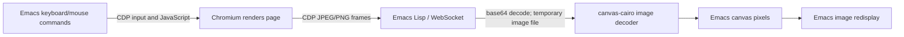
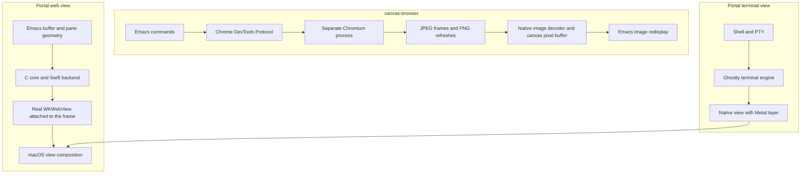

# Emacs 32 canvas, canvas-browser, and Portal

Research date: 2 October 2026. This note separates upstream source facts from architectural inferences. The upstream applications were inspected, not installed or benchmarked here.

The practical recommendation is to keep Portal's native WebKit and Ghostty views, while considering canvas for inline graphics that need to participate in buffer layout. Canvas adds a presentation primitive; it does not replace browser engines, terminal renderers, or document bridges. The comparison and recommendations below explain that distinction.

## What changed in Emacs

Canvas is now part of GNU Emacs development, not merely a proposed patch or an external package. The feature landed on 16 August 2026 in [commit d5f515e4a335](https://github.com/emacs-mirror/emacs/commit/d5f515e4a3350079330c2e80f3681d140d649c88); current [Emacs 32 NEWS](https://github.com/emacs-mirror/emacs/blob/60a68b1b5d9b8821de3c0c8853d31afb70e9b68a/etc/NEWS#L490-L500) announces the image type and module function. The [original patch repository](https://github.com/minad/emacs-canvas-patch) also says it is in the Emacs 32 source tree. Earlier `make-canvas` / `canvas-put` / `canvas_pixel` examples describe previous proposals, not the current API.

The inspected upstream packages require a development build, Emacs 32.0.50, with canvas support and dynamic modules; installing the Lisp packages cannot give an older Emacs the new C API. Their documentation describes Emacs 32 as unreleased. This is a dependency on development Emacs, not a requirement for a separately maintained canvas fork. [canvas-diagram requirements](https://github.com/Daskeladden/canvas-diagram/blob/3d2b4a0618a5276174ddcf80a08b94c18f5eaa16/README.md#requirements)

The core abstraction is **a mutable image with an ARGB32 pixel buffer**. It is not the browser HTML Canvas API, a widget toolkit, or a function that embeds arbitrary application windows. A canvas lives in Emacs's normal image/display-property machinery, so it can appear inside text or on an overlay. It supports ordinary image sizing and mapping properties. [Emacs canvas documentation](https://github.com/emacs-mirror/emacs/blob/60a68b1b5d9b8821de3c0c8853d31afb70e9b68a/doc/lispref/display.texi#L7484-L7590)

A small Lisp example, adapted to illustrate the documented interface:

```elisp
(let* ((pixels (make-vector (* 200 100) #xFF204060))
       (image (create-image pixels 'canvas t
                            :data-width 200 :data-height 100)))
  (insert (propertize " " 'display image))
  (aset pixels 0 #xFFFF0000)
  (canvas-refresh image t))
```

Here `t` reloads the vector into the canvas. Pixel data can alternatively come from an unibyte string or raw file. Reusing the image avoids making a fresh Lisp image object for every frame. A command or timer is followed by normal redisplay; a tight animation loop must call `redisplay` itself. [Lisp API and refresh examples](https://github.com/emacs-mirror/emacs/blob/60a68b1b5d9b8821de3c0c8853d31afb70e9b68a/doc/lispref/display.texi#L7484-L7590)

For efficient native drawing, an Emacs dynamic module calls:

```c
uint32_t *pixels = env->canvas_data(env, canvas);
/* Write row-major ARGB32 pixels, then call canvas-refresh in Lisp. */
```

The pointer is valid only while the canvas remains alive and its dimensions remain unchanged. Modules must retain the Lisp object and reacquire the pointer after resizing. The API supplies pixel access; renderers supply shapes, text, image decoding, timing, and interaction. There is no renderer callback that Emacs pulls automatically, GPU texture handle, or native-view embedding operation in this canvas module interface. [Module Canvas API](https://github.com/emacs-mirror/emacs/blob/60a68b1b5d9b8821de3c0c8853d31afb70e9b68a/doc/lispref/internals.texi#L2024-L2069)

Thus updates are application-driven: write pixels, request refresh, let Emacs display them. A package can choose a timer, subprocess events, or another trigger; that scheduling choice is not dictated by canvas.

## Where copies and platform differences remain

The core implementation matters more than the phrase “direct pixel buffer.” In the inspected `canvas_prepare_for_display`:

| Emacs display backend | How refreshed pixels reach its image |
|---|---|
| Cairo | Reuses the display surface, but `memcpy`s canvas pixels into it. |
| X11 without Cairo | Reuses the pixmap, converts pixel data, then uploads an X image. |
| Android | Reuses the pixmap and transfers pixel data. |
| Cocoa/NS | Resets/recreates the image pixmap and fills it pixel by pixel; source calls this a workaround. |
| Generic fallback | Recreates images/pixmaps and fills them. |

This is broader platform support, not identical performance everywhere. `canvas-refresh` updates a generation and redraws image glyphs; the final buffer flip waits for redisplay. The public refresh operation has no dirty-rectangle parameter. [Core presentation implementation](https://github.com/emacs-mirror/emacs/blob/60a68b1b5d9b8821de3c0c8853d31afb70e9b68a/src/image.c#L5742-L5907)

Inference: avoiding Lisp allocation and encoded images is valuable, but canvas is not an end-to-end zero-copy presentation promise. CPU drawing, image decoding, upload/copy work, display backend, resolution, and scheduling still determine latency. In particular, a Cocoa result cannot be predicted from a Linux/Cairo demonstration.

## What canvas-browser actually embeds

The browser engine remains Chromium in another process. Emacs speaks Chrome DevTools Protocol (CDP) directly over WebSocket, with one page target/session per buffer. The current launcher defaults to a **headed Chromium on a hidden Xvfb display**, despite the repository's opening description calling it headless. `canvas-browser-headless` enables the alternative `--headless=new` path. There is no intermediate Python/Node browser bridge, but Chromium, its subprocesses, and usually Xvfb are still present. [CDP connection and launcher](https://github.com/Daskeladden/canvas-browser/blob/02ad10f955294d8305cf3f18d0f674c3846df441/canvas-browser-cdp.el#L158-L326)



CDP provides screencast frames as base64 image data, with acknowledgments; screenshot capture is a separate request. These are image transport APIs, not a shared browser surface. [CDP Page protocol](https://chromedevtools.github.io/devtools-protocol/tot/Page/)

The implementation receives compressed images, decodes base64, hashes bytes to avoid repeats, writes a per-page temporary file (`/dev/shm` when writable), and invokes `canvas-cairo-image`. The native decoder reads PNG through Cairo or other formats through GdkPixbuf; it converts to a Cairo surface and paints into the canvas. The browser's pixels are therefore not passed directly from Chromium into Emacs's display surface. [Browser painting](https://github.com/Daskeladden/canvas-browser/blob/02ad10f955294d8305cf3f18d0f674c3846df441/canvas-browser.el#L134-L271), [native image decoding](https://github.com/Daskeladden/canvas-diagram/blob/3d2b4a0618a5276174ddcf80a08b94c18f5eaa16/canvas-cairo.c#L856-L1000)

This produces an image that belongs to the Emacs buffer. The package can paint hints over it, crop images, or insert a page picture inside another buffer. Page text is still owned by Chromium: obtaining ordinary Emacs text, caret motions, selection, and search requires additional DOM/CDP integration. Canvas does not turn browser content into native buffer text. [Browser interface](https://github.com/Daskeladden/canvas-browser/blob/02ad10f955294d8305cf3f18d0f674c3846df441/README.md)

## Dependency boundaries

| Component | Responsibility |
|---|---|
| Emacs 32 canvas | Mutable pixel storage and display; core feature. |
| `canvas-diagram` | Contains `canvas-cairo.so` plus a higher-level diagram framework; browser mainly uses the module. |
| `canvas-cairo` | Wraps canvas memory in a Cairo surface; Pango supplies fonts; exports drawing/decoding operations. |
| `canvas-keys` | Shared keymaps and package callback conventions, not a renderer. |
| `websocket` and `transient` | CDP transport and menus. |
| Chromium / usually Xvfb | Browser engine and hidden Linux display. |
| Optional `kill-ring-images`, `canvas-minimap`, `smear-cursor` | Image copying, minimap commands, visual focus/copy effects. |

The browser requires `canvas-cairo` and `canvas-keys`, not all of the diagram UI. There is no separate required `emacs-canvas` Lisp package in its dependency declarations. [Browser package declarations](https://github.com/Daskeladden/canvas-browser/blob/02ad10f955294d8305cf3f18d0f674c3846df441/canvas-browser.el#L1-L23), [canvas-keys requirements](https://github.com/Daskeladden/canvas-keys/blob/510c5fbc5b8d402a9b717ccd99f248c1b935eccf/README.md#requirements)

The native module needs Cairo/Pango and the Emacs 32 module header. Its drawing surface uses the canvas's own buffer, but its decoded images have intermediate surfaces. GdkPixbuf is nominally optional in the build; without it only PNG decoding works, so it is effectively needed for the browser's JPEG stream. Librsvg enables SVG operations. [Module surface setup](https://github.com/Daskeladden/canvas-diagram/blob/3d2b4a0618a5276174ddcf80a08b94c18f5eaa16/canvas-cairo.c#L282-L376), [build dependencies](https://github.com/Daskeladden/canvas-diagram/blob/3d2b4a0618a5276174ddcf80a08b94c18f5eaa16/Makefile#L8-L54)

The core API is portable across graphical Emacs builds. The *application's default deployment* is Linux/X11-oriented: Xvfb, `/tmp/.X11-unix`, Linux executable names, and snap handling. It provides a headless option, but the inspected sources do not establish a tested, turnkey native macOS/Windows browser setup. Treat its broad portability statement as architectural potential, not a verified platform matrix. [Launcher source](https://github.com/Daskeladden/canvas-browser/blob/02ad10f955294d8305cf3f18d0f674c3846df441/canvas-browser-cdp.el)

## Input, IME, and integration cost

The input path is also mediated. Emacs keymaps switch between navigation and insert states; ordinary characters become `Input.dispatchKeyEvent` calls, special editing keys are translated, yank uses `Input.insertText`, and mouse positions become CDP events. The package implements browser selection/caret behavior through JavaScript. This gives Emacs deliberate control over commands, but those behaviors are package work rather than consequences of the pixel API. [Keyboard implementation](https://github.com/Daskeladden/canvas-browser/blob/02ad10f955294d8305cf3f18d0f674c3846df441/canvas-browser.el#L894-L1233)

No `imeSetComposition`, marked-text, or preedit bridge was found in the browser source. CDP does have [`Input.imeSetComposition`](https://chromedevtools.github.io/devtools-protocol/tot/Input/), so implementing composition is possible. Absence of that bridge does **not** prove committed Unicode or an Emacs input method fails. It means native browser IME composition, candidate placement, and surrounding-text behavior should be tested rather than assumed equivalent to a native webview. Canvas itself supplies no text-input protocol.

Likewise, a canvas image alone supplies neither an accessible DOM nor native browser context menus, drag-and-drop, file pickers, permissions UI, or downloads. A browser built over it must implement/integrate each desired capability. This is an architectural consequence of transporting pixels and commands; it is not a claim that Chromium lacks those features.

## Performance: evidence and limits

The browser's normal screencast paint scheduler defaults to one paint per 0.08 seconds—a nominal cap of roughly **12.5 streamed paints/second**—and keeps only the latest pending frame. Still-image refreshes are separate work. That cap is a package policy, not an Emacs canvas limit. Movement uses quality-70 JPEG. The package requests a lossless PNG after 0.4 seconds of input quiet; while limited regions animate, it clips incoming frames to those regions and refreshes the still picture every two seconds. Changes outside the inferred animated regions can wait for the next still. [Frame scheduling and refresh policy](https://github.com/Daskeladden/canvas-browser/blob/02ad10f955294d8305cf3f18d0f674c3846df441/canvas-browser.el#L273-L531)

The author reports, for one 1874×921 window, 120 kB / 0.10 seconds for JPEG quality 70 versus 228 kB / 0.22 seconds for PNG, and approximately 3–4 ms for painting decoded content. Those are useful workload observations, not controlled comparisons with Portal or universal latency guarantees. The README also lists video/animation and downloads/printing/devtools among limitations, although it contains embedded-video and animation mechanisms; read that as limited polish/performance, not proof of complete absence. [Author measurements and limitations](https://github.com/Daskeladden/canvas-browser/blob/02ad10f955294d8305cf3f18d0f674c3846df441/README.md#while-it-moves-and-once-it-stops)

No local browser/Portal benchmark was performed for this note. The defensible comparison is the observed work in each pipeline, not an invented speedup. Canvas could improve a design currently recreating PNG/Lisp images each frame; replacing a native GPU-backed view with screenshot transport introduces a different set of costs.

## A revealing adjacent project: excali-mode

[`yibie/excali-mode`](https://github.com/yibie/excali-mode/blob/dadd9fb3f86443045655f34e88880b2e44f6cf9b/README.org) is an unofficial Excalidraw-compatible editor: Elisp owns the scene and editing commands; C/Cairo/Pango render it. It is not the upstream JavaScript application running inside a webview. This makes it a useful example of canvas enabling a new implementation, rather than automatically hosting an existing UI.

More tellingly, its default `auto` backend chooses a **CoreAnimation overlay on macOS**, bypassing `canvas-refresh`; elsewhere it uses multiple canvas tiles and refreshes changed tiles. The Cocoa implementation attaches a CALayer to the Emacs view and copies pixels into double-buffered IOSurfaces. Mouse events still go to Emacs. [Backend choice](https://github.com/yibie/excali-mode/blob/dadd9fb3f86443045655f34e88880b2e44f6cf9b/excali-view.el#L158-L183), [native layer implementation](https://github.com/yibie/excali-mode/blob/dadd9fb3f86443045655f34e88880b2e44f6cf9b/src/excali-layer.m#L1-L81)

This is concrete evidence that Emacs-owned interaction and native presentation can be combined. Choosing canvas for content does not force all platforms through the same presentation path, and native embedding does not become obsolete merely because canvas exists.

## Inspected upstream snapshots

- GNU Emacs master: [`60a68b1b5d9b`](https://github.com/emacs-mirror/emacs/commit/60a68b1b5d9b8821de3c0c8853d31afb70e9b68a), 1 October 2026.
- canvas-browser: [`02ad10f95529`](https://github.com/Daskeladden/canvas-browser/commit/02ad10f955294d8305cf3f18d0f674c3846df441), 1 October 2026; package version 0.1.0.
- canvas-diagram: [`3d2b4a0618a5`](https://github.com/Daskeladden/canvas-diagram/commit/3d2b4a0618a5276174ddcf80a08b94c18f5eaa16), 1 October 2026; README calls it a prototype.
- canvas-keys: [`510c5fbc5b8d`](https://github.com/Daskeladden/canvas-keys/commit/510c5fbc5b8d402a9b717ccd99f248c1b935eccf), 1 October 2026.
- excali-mode: [`dadd9fb3f864`](https://github.com/yibie/excali-mode/commit/dadd9fb3f86443045655f34e88880b2e44f6cf9b), 1 October 2026.


## Comparison with Portal at `80287321122c`

Portal's implementation was inspected at commit
`80287321122ce48247708f30f950c713d93ee3f7`. The following describes implemented
behavior, rather than possible future platform backends.



The arrows summarize responsibilities, not every internal process or copy. WebKit
itself uses supporting processes; Portal does not put an entire browser engine
inside Lisp. In both approaches a real browser engine lays out the page.

### Rendering and composition

Portal attaches a native AppKit view to the Emacs frame's content view using
`addSubview`. Lisp obtains the chosen pane's pixel rectangle and asks the module
to place the view there. A temporary unique frame title lets the native host find
the matching NSWindow. Emacs manages the pane, but does not redisplay the web page
or terminal as buffer glyphs. [Portal placement](../native/NativeHost.swift),
[Lisp geometry and frame lookup](../portal-view.el).

That is why Portal carries explicit placement, focus, reparenting, and lifetime
machinery. One buffer has one native view, shown in one chosen pane. Showing the
same buffer in another pane does not create another presentation of the view.
Hidden views move to a retained offscreen parking window; terminal rendering can
stop while its session continues. [View lifecycle](../native/Views.swift),
[one-view decision](adr/0001-one-portal-view-per-buffer.md),
[terminal attachment](../native/Terminal.swift).

A canvas instead participates in Emacs's normal image display: text and images
can surround it, and Emacs handles their clipping and placement in the buffer.
This makes inline interactive graphics a materially different opportunity from
Portal's current whole-pane views. Image reuse does not provide independent web
viewports automatically: packages still decide session identity, viewport size,
and input routing when one object appears in multiple windows. The pixels also
do not become editable buffer text or an accessibility tree; browser-text
extraction and selection remain separate features.

### Input and application integration

Portal lets WebKit and Ghostty handle native app input, with shared C-core rules
for handing unused chords back to Emacs. Its platform code preserves native
events, modifier changes, and releases across the handoff. The input design also
explicitly accounts for WebKit's input-method queue. This is useful when the goal
is that a hosted application behaves like its ordinary app while Emacs owns
commands, buffers and splits. [Input bridge](terminal-input-bridge.md),
[native input](../native/NativeInput.swift).

canvas-browser makes Emacs commands the browser controls and translates them
into CDP events and DOM operations. Its link hints, caret motions, bookmarks,
text extraction and normal/insert states are substantial package-level work.
They are not features supplied by the canvas API. The native-view approach can
also implement hints or text extraction with browser scripting; choosing canvas
is not a prerequisite for those features. Conversely, using canvas means input,
IME behavior, clipboard operations and browser dialogs need deliberate
integration rather than arriving as an embedded native widget.

Portal's hosted apps have a separate semantic bridge. The C core validates
messages and lifecycle, and Swift transports messages to/from WebKit. Excalidraw
uses this to keep document JSON, modified state and saving in Emacs. Replacing the
display with a canvas would not replace that document protocol. A Chromium
backend would still have to implement the equivalent transport and preserve its
behavior. The hosted app's `portalBridge` interface already avoids directly
naming WebKit. [Hosted bridge](editor-bridge.md),
[WebKit implementation](../native/WebView.swift),
[portable platform boundary](adr/0003-platform-interface-primitives.md).

### Ghostty specifically

Portal pins `libghostty-spm` **1.6.20260909**, commit
`7e45d27160f9b34aca9ca5c9820e9207482f9f04`. Its `AppTerminalView` is an NSView
with a `CAMetalLayer`; it hands its NSView pointer to Ghostty's macOS platform
configuration. Portal subclasses that wrapper and retains the session. This is
not a web terminal or a stream of terminal screenshots.
[Dependency pin](../native/Package.resolved),
[Portal terminal](../native/Terminal.swift),
[pinned wrapper source](https://github.com/Lakr233/libghostty-spm/blob/7e45d27160f9b34aca9ca5c9820e9207482f9f04/Sources/GhosttyTerminal/Platform/AppKit/AppTerminalView.swift).

**Inference:** a Ghostty canvas backend would need an offscreen pixel-producing
renderer/readback route, or a separate renderer for terminal state, plus Emacs
input integration. `canvas_data` accepts neither this native view nor its Metal
texture. It is not a one-line replacement for attaching the existing view. A
raw-pixel producer could avoid JPEG entirely; canvas-browser's compression is
its own transport choice, not a canvas requirement.

The existing native path avoids adding screenshot encoding/decoding and Emacs
image redisplay between Ghostty's renderer and presentation. That supports keeping
it as the default for a responsive macOS terminal. It does **not** establish a
measured latency or frame-rate advantage: AppKit, Emacs's process, the GPU and OS
scheduling still interact. Portal's existing benchmark notes explicitly separate
PTY/parser throughput from visible frame rate and key-to-pixel latency.
[Benchmark method and limits](terminal-benchmark.md).

## What should change for Portal?

This is a design recommendation, not a benchmark result:

| Need | Direction supported by the evidence |
| --- | --- |
| Whole-pane macOS web apps, including our existing Excalidraw app | Keep the native WebKit view; investigate specific shortcomings before changing engines or presentation. |
| Responsive macOS terminal with Ghostty's native rendering and input | Keep the native Ghostty view. Canvas supplies no direct Metal-surface integration. |
| Inline diagrams, charts, small previews, or several graphics among Org text | Explore canvas as an additional presentation capability. This is its strongest new opportunity for Portal. |
| Emacs-centric general browsing, Chromium compatibility, extensions and hints | Evaluate canvas-browser as a separate browser experience; distinguish its browser features from its display technology. |
| Broader desktop portability | Canvas reduces dependence on embedding each platform's native widgets, but browser launch, native-module dependencies, input and performance still need platform validation. |

Upgrading to Emacs 32 does not automatically simplify Portal's current native
view machinery: that machinery still hosts real views. We would simplify or
remove it only for content we deliberately migrate into Emacs's image display.
The two approaches can coexist.

A useful first experiment would be a small inline preview or diagram on macOS
Emacs 32, with measurements of refresh cost, Retina scaling, scrolling/clipping,
input and behavior under normal Emacs work. For a browser or terminal experiment,
compare identical workloads and key-to-visible-pixel latency, frame pacing, CPU,
RSS and image quality. Do not use supplied frames or PTY replies as proof of
presented FPS.

## Local verification and limits

- The command-line Emacs inspected here reports **31.1**, without `canvas-refresh`
  or the `canvas` image type. That is evidence about this executable, not every
  Emacs installation on the machine.
- This report inspects source and documentation. It does not claim a local
  canvas-browser installation, successful macOS canvas-browser operation, IME
  validation, or a head-to-head performance benchmark.
- No Portal runtime code, task status, or dependencies were changed.

The existing project CTest suite was run against the unchanged code at the same
commit using the main checkout's existing build: 18/24 suites passed initially.
Six suites hit the local native compiler's missing `emutls_w` linker search path;
all six passed when rerun with `LIBRARY_PATH` pointing at the installed GCC 15
archive directory. All 24 suites therefore passed across those runs; no test or
runtime code was modified. This checks the Portal baseline, not canvas support.
