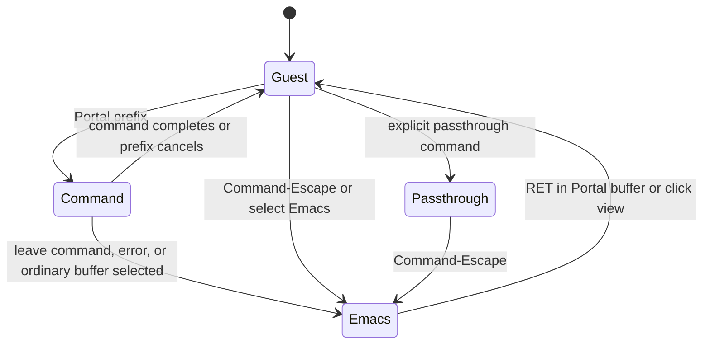

# Portal input design proposal

> **Superseded on 30 September 2026.** Portal no longer has a prefix or
> passthrough. Views behave as their apps do outside Emacs, and a chord an app
> does not use falls through to Emacs; Command-Escape is the one reserved key.
> See [the input bridge](terminal-input-bridge.md) and
> [its task](../tasks/input-chord-fall-through.md). This proposal is kept for its
> research.

Research date: 22 September 2026. This is a proposal, not implemented behavior.
It is based on the working tree at the research date and the primary sources linked below.

Implementation note, 23 September: the initial implementation now provides the
shared prefix, Emacs gateways, feature maps, focus/header controls, passthrough,
literal native input, and stale-handoff cancellation described here. Existing
terminal prefix configuration remains an alias. The legacy web interceptions
were removed directly. Expanded delayed help, a key-routing inspector, general
native shortcut maps for webviews, and a transport watchdog remain possible
follow-ups; they are not part of this minimal trial. The historical inventory
and proposed API names below describe the research stage; see the
[keyboard guide](keyboard.md) for current usage.

Portal should give every embedded application the same input contract: the
application receives ordinary input; a configurable Portal prefix temporarily
gives commands to Emacs; an explicit escape returns control to Emacs until the
user re-enters the application. Terminal, drawing editor, and arbitrary web app
should share this contract.

For the current user, retain `C-b` as that prefix. Make it a Portal setting rather
than a terminal setting. Keep the default reservation scoped to Portal views and
their Emacs wrapper buffers. Binding `C-b` globally in ordinary text buffers
would replace backward-character and should not be a package default.

The important consistency is ownership, command meaning, cancellation, and focus
after commands. Giving every surface the same first chord while retaining
different rules for those things would leave much of the problem unresolved.

Current behavior illustrates the differences:

| Surface | While the native view has focus | Returning to the view |
| --- | --- | --- |
| Regular terminal | `C-b` dispatches the terminal map; Command-Escape returns to Emacs; ordinary Escape and `C-g` reach the terminal | Prefix commands normally resume the selected terminal; explicit unfocus stays in Emacs; `RET` enters |
| Quick terminal | Same first chord, with a separate restricted command map | Same terminal dispatcher; dismissal leaves the panel hidden |
| Excalidraw | Native `C-x` hands an Emacs prefix to the command loop; Command-Escape leaves; bare Escape reaches the editor | The native `C-x` path leaves focus in Emacs; the separate save-message path explicitly refocuses the editor; `RET` enters |
| HTML/Markdown/general webview | Escape-key events and Control-G combinations return to Emacs | Click to enter; no corresponding `RET` binding or shared prefix in `portal-mode-map` |

Evidence: [terminal dispatch](../portal-terminal.el#L356),
[terminal native routing](../native/Terminal.swift#L130),
[editor dispatch](../portal-excalidraw.el),
[webview routing](../native/WebView.swift#L46), and
[preview mode map](../portal.el#L41). The Excalidraw page also handles
Control-S/Command-S as an application save action in `host/excalidraw.tsx`.

Several prior designs expose useful choices:

| Prior art | Mechanism | Lesson for Portal |
| --- | --- | --- |
| [tmux](https://man.openbsd.org/tmux#KEY_BINDINGS) | A configurable prefix selects host commands; `send-prefix` delivers the reserved key to the nested application | Reserve little input and provide an explicit literal path. Existing tmux muscle memory is valuable |
| [WezTerm](https://wezterm.org/config/keys.html#leader-key) | A leader activates a command layer; unmatched keys are swallowed; its leader expires after a configured interval | Make invalid sequences and waiting behavior deliberate. Portal can keep its existing untimed Emacs prefix rather than inherit a timer |
| [Zellij](https://zellij.dev/tutorials/colliding-keybindings/) | An Unlock-First preset puts access to its input modes behind an unlock operation; modifiers remain configurable | A rich host interface needs a way to stop competing with guest shortcuts |
| [vterm](https://github.com/akermu/emacs-libvterm/blob/master/vterm.el) | `vterm-keymap-exceptions` reserves selected keys/prefixes for Emacs; defaults include `C-x`, `C-c`, and `M-x` | Familiar Emacs commands can be immediately available, with a corresponding cost to terminal input |
| [VS Code](https://code.visualstudio.com/docs/terminal/advanced#_keyboard-shortcuts-and-the-shell) | `commandsToSkipShell`, `sendKeybindingsToShell`, and `allowChords` control which shortcuts go to the editor | Selective direct shortcuts are useful customization, but a long exception policy becomes another thing to understand |
| [qutebrowser](https://qutebrowser.org/doc/help/settings.html#bindings.commands) | Insert mode has some browser bindings; passthrough mode leaves only Shift-Escape to exit | Being inside a text field is different from giving a whole application control of input |
| [emacs-webkit](https://github.com/akirakyle/emacs-webkit#usage) | Insert mode moves focus into the webview; `C-g` returns to Emacs | Explicit ownership is a close precedent. Its documented inspector exception also shows why recovery scope must be tested |
| [EAF](https://github.com/emacs-eaf/emacs-application-framework/wiki/EAF-Framework#bind-python-interactive-function-from-elisp) | `insert_or_do` supports commands that insert into focused browser input fields or perform an action | Contextual routing can improve reading interfaces, but input-field detection alone cannot define the policy for every web app |

These are mechanisms to learn from, not claims that the projects all implement
the same policy. The recommendation below is a synthesis for Portal.

There are four viable approaches:

| Approach | Example from a focused guest | Strength | Cost |
| --- | --- | --- | --- |
| Shared prefix | `C-b o` changes pane; `C-b C-x C-s` requests an Emacs save | Builds on the current terminal, reserves little input, works without understanding the guest | One extra chord for host commands; literal `C-b` needs quoting |
| Emacs prefixes always available | `C-x C-s`, `C-x o`, `M-x` immediately reach Emacs | Reuses existing muscle memory with fewer keystrokes | Every intercepted first chord blocks guest sequences, including terminal programs and browser editors |
| Explicit focus switching | Command-Escape, ordinary Emacs commands, then `RET` | Very small new vocabulary; guest input is predictable | Leaving and re-entering adds steps to frequent one-off commands |
| Dedicated host modifier | User-selected Super chords work in Emacs and native views | Can offer identical physical bindings everywhere with fewer Control collisions | Needs user configuration; Command is already used by macOS and web apps; Hyper would require more modifier support in the current bridge |

The first approach, with explicit focus switching also available, is the best
default fit here. The fourth is a useful user preset if identical physical
bindings in ordinary Emacs buffers are essential. It is a choice of trigger and
optional aliases, not a separate implementation of input routing. No modifier
can promise freedom from all OS, Emacs, terminal, and web-app conflicts.

Let `P` mean the configured prefix, initially `C-b`. A small shared map could be:

| Input | Meaning on every Portal surface |
| --- | --- |
| `P ?` | Show the effective bindings and available actions, including customization |
| `P d` | Give control to Emacs and stay there |
| `P :` or `P M-x` | Execute an Emacs command |
| `P o` | Select the next Emacs window |
| `P C-x …` | Execute the corresponding existing Emacs `C-x …` sequence |
| `P C-c …`, `P C-h …` | Equivalent explicit gateways for existing mode commands and help |
| `P m` | Open commands specific to this surface |
| `P P` | Send one literal prefix chord to the originating guest |
| `C-g` while reading a Portal prefix | Cancel the prefix and resume the originating guest if it is still the intended target |
| Command-Escape | Immediately give control to Emacs and stay there |
| `RET` in an Emacs-owned Portal wrapper buffer | Explicitly enter its native view |

`P C-x` should dispatch through the user's applicable Emacs bindings, including
command remapping, rather than duplicate a hard-coded list of save/split/file
commands. For an arbitrary sequence outside the provided gateways, `P d` already
exposes all normal Emacs bindings. This avoids requiring a second large command
vocabulary. The gateways are proposed behavior, not currently available APIs.

Examples under this design:

- Excalidraw: `C-b C-x C-s` saves through Emacs, finishes any filename prompt,
  then returns to drawing if the same view remains selected.
- Any Portal view: `C-b o` selects another pane. An ordinary Emacs buffer keeps
  Emacs input; a selected Portal view receives native input.
- Browser Vim: bare Escape, `C-x`, and `C-g` remain available to the web app.
  `C-b d` leaves it; `RET` re-enters after using Emacs.
- Nested tmux using `C-b`: `C-b C-b c` delivers `C-b c` to tmux. Deeper nesting
  increases quoting cost, so a different outer prefix or passthrough is useful.

Existing terminal `P c`, `P n`, `P p`, number selection, and similar tmux
bindings can remain compatibility shortcuts in the terminal profile. New
feature-specific actions belong under `P m`; feature maps must not silently
replace shared operations such as `P d` or `P o`. Keep the quick terminal's
special lifecycle commands in its own extension. Shared pane navigation can
work there without enabling its intentionally absent terminal creation workflow.

Semantic consistency does not require pretending every surface supports the
same operations. Saving a drawing is meaningful; saving a terminal is not the
same action. Reloading a preview, rebuilding an Excalidraw editor, and resetting
a shell have very different effects. Those should not share an ambiguous global
`r` binding. Similarly, hiding a view, closing a pane, and terminating its session
should remain separately named operations. Current previews are disposable while
terminal and editor sessions persist; a binding change alone does not make their
lifecycle guarantees identical.

The input states need to be explicit:

The diagram's return to Guest is conditional on the selected destination still
being a live Portal view and on no minibuffer or newer user focus change taking
precedence. Prefix waiting is temporary command state, not another persistent
editing mode. There should be no default deadline to finish typing a prefix.

In normal guest input, Portal intercepts only its prefix, its escape hatch, and
explicitly configured direct aliases. It does not take Escape, `C-g`, `C-c`,
Tab, or all `C-x` sequences merely because the surface is a browser. Existing
backend behavior, such as Ghostty clipboard shortcuts or Excalidraw tools, still
applies after Portal's routing decision.

Passthrough is an optional command for applications that need the prefix often.
It disables Portal's normal prefix and direct shortcut interceptions for that
view, leaving the native escape hatch and clickable Emacs chrome available.
Leaving passthrough resets it to normal guest policy for the next entry, so a
disabled prefix does not silently persist. It passes keys as far as the OS and
underlying terminal/browser allow; it cannot override system-wide shortcuts.

Bare Escape belongs to the current owner. It cancels drawing operations, exits
Vim insert mode, or interacts with an IME when the guest owns input. `C-g` is an
Emacs quit only when Emacs owns the command or minibuffer. A prefix cancellation
must not also send `C-g` into the guest. Command-Escape is an idempotent return to
Emacs, not a toggle that could accidentally send the user back into the guest.

For known reading views, opening with Emacs focus and offering explicit scroll
or link commands is reasonable. `RET` or a click can enter interactive content.
This is an initial-focus preference, not permission to change ownership whenever
JavaScript focuses an input. Canvas editors, contenteditable regions, frames,
and web Vim make input-field heuristics insufficient for arbitrary pages.
Optional integrations can report capabilities; they should not decide whether
the universal prefix is allowed to work.

Focus after a command is part of the interface:

- Complete synchronous commands and their minibuffer interaction before handing
  back input. Saving should resume drawing only after the save barrier succeeds.
- Commands that stay in the same selected native view normally resume it.
  Shared navigation can enter the selected destination native view.
- Explicit return to Emacs, errors, help intended for interaction, and selection
  of ordinary buffers leave Emacs in control.
- Asynchronous callbacks must not refocus a view after the user has moved
  elsewhere. Native focus should track a live surface and interaction identity,
  not merely whether some terminal buffer is still selected.
- Unknown prefix sequences report an undefined Portal command. They must not
  fall through into shell input or edit a drawing's backing JSON buffer.

Visible ownership reduces mistakes more than another shortcut list. Every
surface should use the same compact indicator: `Portal: App`, `Portal: Emacs`,
`Portal: Command`, or `Portal: Passthrough`, with the actual configured escape
and prefix shown where appropriate. Prefix entry can show a short hint
immediately and expand the effective map after a delay; a help-display delay
must not expire the prefix. `P ?` should show what is available and where an
override came from. A describe-input command should explain the recipient of a
key and any known reservation, without executing that key in the application.

The implementation can build on existing boundaries. [NativeHost](../native/NativeHost.swift#L113)
already routes input for all native surfaces and tracks key ownership across
focus changes. [Runtime terminal bindings](../portal-terminal-bindings.el#L32)
already compile first chords, validate collisions, and register them atomically.
The [terminal input bridge](terminal-input-bridge.md) already keeps commands and
prefix tails in Lisp and buffers rapid typing until Lisp acknowledges handoff.

Extract a reusable input bridge alongside NativeHost, with per-surface context
and adapters for focus, literal event delivery, and capability commands. The
shared bridge should own reservation, capture, cancellation, and handoff policy;
Ghostty keeps terminal encoding, and WebKit keeps browser input and IME handling.
Document synchronization and persistence remain separate from keyboard policy.
Generic previews will also need an explicit focus API and an originating
buffer/window identity for dispatch.

Proposed names such as `portal-input-prefix`, `portal-command-map`, and
`portal-native-map` describe the intended API shape only. Build the effective
map from a shared map and feature extensions, compile only explicitly registered
first chords, and leave direct host shortcuts opt-in. Do not automatically export
every global Emacs binding to native views. Runtime edits should retain the
current atomic validation and rollback behavior.

Recovery must precede ordinary capture and must not depend on a web page
acknowledging a snapshot. Native Command-Escape should release capture and
return focus even if Lisp handoff or page synchronization is stalled. It cannot
make a blocked Emacs command loop or blocked AppKit main thread responsive, but
it should not add a dependency on the guest process. A transport acknowledgement
watchdog is distinct from a user prefix timeout: it cleans up a failed bridge
without demanding faster typing.

Literal delivery is a significant browser validation item. Reuse captured native
events with a narrowly scoped bypass of interception and preserve their target,
ordering, key releases, and modifier transitions. A JavaScript-generated
KeyboardEvent should not be assumed to reproduce browser editing and shortcut
behavior. The same tests must cover rapid prefix tails, minibuffer typing,
autorepeat, changed focus, stale sessions, and surface deletion. Recovery must
avoid replaying a half-read command into the application or a different buffer.

Migration should first add the shared gateway and help to all surfaces. Preserve
existing terminal settings/maps with explicit compatibility handling rather than
silently discarding customization. During transition, label legacy Excalidraw
`C-x` and preview Escape/`C-g` interception as compatibility options. The final
cohesive default should release those extra native reservations. Command-S can
remain a documented drawing-specific accelerator because it invokes the same
save action; nobody needs to learn it to use the shared gateway.

Before changing defaults, verify the input contract in actual native views:
terminal shell and Vim, Excalidraw drawing/text/IME, Markdown preview, a web text
editor using Vim bindings, nested tmux, quick terminals, multiple panes, live
rebinding, and unavailable surfaces. Test both ordinary guest input and Portal
commands, including literal prefix delivery to WebKit. Confirm that the same
sequences produce the same ownership transitions everywhere. This proposal is
based on code inspection and documentation research; it does not claim those
new behaviors have been implemented or tested.
