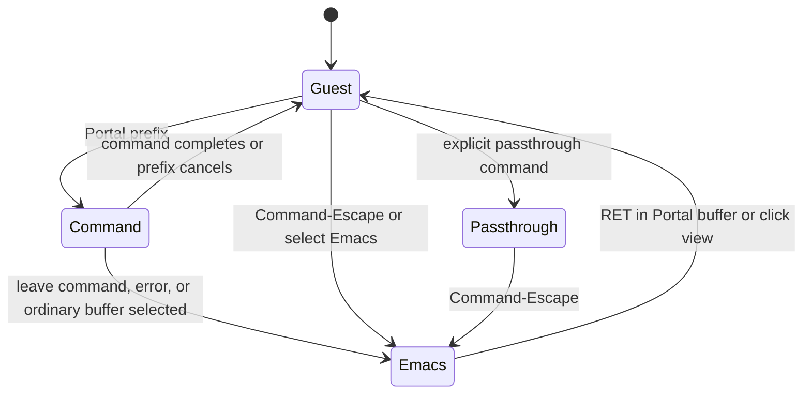

# Portal input design proposal

> **Superseded on 30 September 2026.** Portal no longer has a prefix or
> passthrough. Views behave as their apps do outside Emacs; unused chords fall
> through to Emacs. Command-Escape is the only reserved key. See
> [the input bridge](terminal-input-bridge.md) and
> [its task](../tasks/input-chord-fall-through.md). Retained for its research.

Research date: 22 September 2026. This proposal, not implemented behavior,
is based on that date's working tree and the primary sources below.

Implementation note, 23 September: the initial implementation provides the shared
prefix, Emacs gateways, feature maps, focus/header controls, passthrough, literal
native input, and stale-handoff cancellation described here. Existing terminal
prefix configuration remains an alias. Legacy web interceptions were removed
directly. Expanded delayed help, a key-routing inspector, general native shortcut
maps for webviews, and a transport watchdog remain possible follow-ups outside
this minimal trial. The inventory and proposed API names below describe the
research stage; see the [keyboard guide](keyboard.md) for current usage.

Every embedded application—terminal, drawing editor, or arbitrary web app—should
share one input contract: ordinary input goes to the application; a configurable
Portal prefix temporarily gives commands to Emacs; an explicit escape gives
Emacs control until the user re-enters the application.

Retain `C-b` for the current user, but make it a Portal rather than terminal
setting. Scope default reservations to Portal views and their Emacs wrapper
buffers. A global `C-b` would replace backward-character in ordinary text buffers
and should not be a package default.

Consistency means shared ownership, command meaning, cancellation, and
post-command focus rules—not just the same first chord.

Current behavior illustrates the differences:

| Surface | While the native view has focus | Returning to the view |
| --- | --- | --- |
| Regular terminal | `C-b` dispatches the terminal map; Command-Escape returns to Emacs; ordinary Escape and `C-g` reach the terminal | Prefix commands normally resume the selected terminal; explicit unfocus stays in Emacs; `RET` enters |
| Quick terminal | Same first chord, separate restricted command map | Same terminal dispatcher; dismissal leaves the panel hidden |
| Excalidraw | Native `C-x` hands an Emacs prefix to the command loop; Command-Escape leaves; bare Escape reaches the editor | Native `C-x` leaves focus in Emacs; the separate save-message path explicitly refocuses the editor; `RET` enters |
| HTML/Markdown/general webview | Escape-key events and Control-G combinations return to Emacs | Click to enter; no corresponding `RET` binding or shared prefix in `portal-mode-map` |

Evidence: [terminal dispatch](../portal-terminal.el#L356),
[terminal native routing](../native/Terminal.swift#L130),
[editor dispatch](../portal-excalidraw.el),
[webview routing](../native/WebView.swift#L46), and
[preview mode map](../portal.el#L41). The Excalidraw page also handles
Control-S/Command-S as an application save action in `host/excalidraw.tsx`.

Prior designs offer useful choices:

| Prior art | Mechanism | Lesson for Portal |
| --- | --- | --- |
| [tmux](https://man.openbsd.org/tmux#KEY_BINDINGS) | A configurable prefix selects host commands; `send-prefix` delivers the reserved key to the nested application | Reserve little input and provide an explicit literal path. Preserve tmux muscle memory |
| [WezTerm](https://wezterm.org/config/keys.html#leader-key) | A leader activates a command layer, expiring after a configured interval; unmatched keys are swallowed | Deliberately choose invalid-sequence and waiting behavior. Portal can keep its untimed Emacs prefix |
| [Zellij](https://zellij.dev/tutorials/colliding-keybindings/) | The Unlock-First preset puts input modes behind an unlock operation; modifiers remain configurable | Rich host interfaces need a way to stop competing with guest shortcuts |
| [vterm](https://github.com/akermu/emacs-libvterm/blob/master/vterm.el) | `vterm-keymap-exceptions` reserves keys/prefixes for Emacs, including `C-x`, `C-c`, and `M-x` by default | Immediate Emacs commands cost terminal input |
| [VS Code](https://code.visualstudio.com/docs/terminal/advanced#_keyboard-shortcuts-and-the-shell) | `commandsToSkipShell`, `sendKeybindingsToShell`, and `allowChords` select editor shortcuts | Direct shortcuts help customization, but long exception policies add complexity |
| [qutebrowser](https://qutebrowser.org/doc/help/settings.html#bindings.commands) | Insert mode retains some browser bindings; passthrough leaves only Shift-Escape to exit | Text-field focus differs from whole-application input ownership |
| [emacs-webkit](https://github.com/akirakyle/emacs-webkit#usage) | Insert mode focuses the webview; `C-g` returns to Emacs | Explicit ownership is a close precedent; its documented inspector exception shows why recovery scope needs testing |
| [EAF](https://github.com/emacs-eaf/emacs-application-framework/wiki/EAF-Framework#bind-python-interactive-function-from-elisp) | `insert_or_do` inserts into focused browser input fields or performs an action | Contextual routing can help reading interfaces, but input-field detection cannot define every web app's policy |

These mechanisms inform Portal's synthesis below; the projects do not necessarily
share a policy.

Four approaches are viable:

| Approach | Example from a focused guest | Strength | Cost |
| --- | --- | --- | --- |
| Shared prefix | `C-b o` changes pane; `C-b C-x C-s` requests an Emacs save | Builds on the terminal, reserves little input, needs no guest knowledge | One extra chord for host commands; literal `C-b` needs quoting |
| Emacs prefixes always available | `C-x C-s`, `C-x o`, `M-x` immediately reach Emacs | Familiar commands with fewer keystrokes | Every intercepted first chord blocks guest sequences, including terminal programs and browser editors |
| Explicit focus switching | Command-Escape, ordinary Emacs commands, then `RET` | Little new vocabulary; predictable guest input | Leaving and re-entering adds steps to frequent one-off commands |
| Dedicated host modifier | User-selected Super chords work in Emacs and native views | Can offer identical physical bindings everywhere with fewer Control collisions | Requires configuration; macOS/web apps already use Command; Hyper needs more bridge modifier support |

Prefer the first approach by default, with explicit focus switching available.
The fourth makes a useful preset for identical physical bindings in ordinary
Emacs buffers: a trigger and optional aliases, not separate routing. No modifier
guarantees freedom from all OS, Emacs, terminal, and web-app conflicts.

Let `P` mean the configured prefix, initially `C-b`. A small shared map could be:

| Input | Meaning on every Portal surface |
| --- | --- |
| `P ?` | Show effective bindings and available actions, including customization |
| `P d` | Give Emacs control and stay there |
| `P :` or `P M-x` | Execute an Emacs command |
| `P o` | Select the next Emacs window |
| `P C-x …` | Execute the corresponding existing Emacs `C-x …` sequence |
| `P C-c …`, `P C-h …` | Equivalent gateways for existing mode commands and help |
| `P m` | Open surface-specific commands |
| `P P` | Send one literal prefix chord to the originating guest |
| `C-g` while reading a Portal prefix | Cancel and resume the originating guest if still the intended target |
| Command-Escape | Immediately give Emacs control and stay there |
| `RET` in an Emacs-owned Portal wrapper buffer | Explicitly enter its native view |

`P C-x` should use applicable user bindings, including command remapping, not a
hard-coded save/split/file command list. `P d` exposes all normal Emacs bindings
outside the gateways, avoiding a second large command vocabulary. These gateways
are proposed behavior, not currently available APIs.

Examples under this design:

- Excalidraw: `C-b C-x C-s` saves through Emacs, finishes any filename prompt,
  then resumes drawing if the same view remains selected.
- Any Portal view: `C-b o` selects another pane. Ordinary Emacs buffers keep
  Emacs input; selected Portal views receive native input.
- Browser Vim: bare Escape, `C-x`, and `C-g` remain available to the web app.
  `C-b d` leaves it; `RET` re-enters after using Emacs.
- Nested tmux using `C-b`: `C-b C-b c` delivers `C-b c` to tmux. Deeper nesting
  increases quoting cost; consider a different outer prefix or passthrough.

Existing terminal `P c`, `P n`, `P p`, number selection, and similar tmux bindings
can remain terminal-profile compatibility shortcuts. Put new feature actions
under `P m`; feature maps must not silently replace shared `P d` or `P o`
operations. Keep quick-terminal lifecycle commands in its own extension. Shared
pane navigation need not enable its intentionally absent terminal creation.

Consistency does not mean identical operations. Saving a drawing differs from
saving a terminal; reloading a preview, rebuilding Excalidraw, and resetting a
shell should not share an ambiguous global `r`. Name hiding a view, closing a
pane, and terminating its session separately. Previews are currently disposable;
terminal and editor sessions persist. Bindings alone cannot unify their lifecycles.

The input states need to be explicit:

Return to Guest requires a live selected Portal destination, with no minibuffer
or newer user focus change taking precedence. Prefix waiting is temporary command
state, not a persistent editing mode. It should have no default deadline.

During normal guest input, intercept only the prefix, escape hatch, and explicitly
configured direct aliases—not Escape, `C-g`, `C-c`, Tab, or all `C-x` sequences
merely because the surface is a browser. Backend behavior, including Ghostty
clipboard shortcuts and Excalidraw tools, still follows Portal's routing decision.

Optional passthrough serves applications that frequently need the prefix. For
that view, it disables normal prefix and direct-shortcut interception while
retaining the native escape hatch and clickable Emacs chrome. Leaving passthrough
restores normal guest policy for next entry, avoiding a silently disabled prefix.
It passes keys only as far as the OS and terminal/browser allow, not past
system-wide shortcuts.

Bare Escape belongs to the current owner: the guest may cancel drawing, exit Vim
insert mode, or interact with an IME. `C-g` is an Emacs quit only for an Emacs-owned
command or minibuffer; prefix cancellation must not also send `C-g` to the guest.
Command-Escape returns to Emacs idempotently, never toggling back into the guest.

Known reading views may open with Emacs focus and explicit scroll/link commands;
`RET` or a click enters interactive content. Initial focus does not authorize
ownership changes whenever JavaScript focuses an input. Canvas editors,
contenteditable regions, frames, and web Vim defeat input-field heuristics for
arbitrary pages. Optional integrations may report capabilities, not decide
whether the universal prefix works.

Focus after a command is part of the interface:

- Finish synchronous commands and minibuffer interaction before returning input.
  Saving resumes drawing only after the save barrier succeeds.
- Normally resume the same selected native view. Shared navigation may enter
  the selected destination native view.
- Explicit return, errors, interactive help, and ordinary-buffer selection leave
  Emacs in control.
- Async callbacks must not refocus after the user moves elsewhere. Track a live
  surface and interaction identity, not just a selected terminal buffer.
- Unknown prefix sequences report an undefined Portal command, never falling
  through to shell input or a drawing's backing JSON buffer.

Visible ownership prevents more mistakes than another shortcut list. Use one
compact indicator across surfaces: `Portal: App`, `Portal: Emacs`,
`Portal: Command`, or `Portal: Passthrough`, showing the configured escape and
prefix where appropriate. Prefix entry can hint immediately and expand the
effective map after a delay, without expiring the prefix. `P ?` should show
available commands and override origins. A describe-input command should explain
a key's recipient and known reservations without executing it in the application.

Build on existing boundaries. [NativeHost](../native/NativeHost.swift#L113)
routes all native-surface input and tracks key ownership across focus changes.
[Runtime terminal bindings](../portal-terminal-bindings.el#L32) compile first
chords, validate collisions, and register atomically. The
[terminal input bridge](terminal-input-bridge.md) keeps commands/prefix tails in
Lisp and buffers rapid typing until Lisp acknowledges handoff.

Extract a reusable bridge alongside NativeHost with per-surface context and
adapters for focus, literal event delivery, and capability commands. It should own
reservation, capture, cancellation, and handoff; Ghostty retains terminal encoding,
WebKit browser input and IME handling. Keep document synchronization/persistence
separate. Generic previews also need an explicit focus API and originating
buffer/window identity for dispatch.

Proposed names `portal-input-prefix`, `portal-command-map`, and `portal-native-map`
describe only the intended API shape. Combine shared maps and feature extensions;
compile only explicitly registered first chords. Keep direct host shortcuts
opt-in, never automatically exporting every global Emacs binding. Retain atomic
validation and rollback for runtime edits.

Recovery must precede ordinary capture without waiting for a web-page snapshot
acknowledgement. Native Command-Escape should release capture and return focus
even during stalled Lisp handoff or page synchronization. It cannot unblock the
Emacs command loop or AppKit main thread, but should not depend on the guest
process. A transport acknowledgement watchdog cleans up bridge failures; unlike
a user prefix timeout, it does not demand faster typing.

Validate browser literal delivery carefully. Reuse captured native events with a
narrow interception bypass, preserving target, ordering, key releases, and modifier
transitions. Do not assume a JavaScript-generated KeyboardEvent reproduces browser
editing/shortcuts. Test rapid prefix tails, minibuffer typing, autorepeat, changed
focus, stale sessions, and surface deletion. Recovery must not replay half-read
commands into the application or another buffer.

Migrate by adding shared gateways and help everywhere first. Explicitly preserve
terminal settings/maps rather than silently discarding customization. During
transition, label legacy Excalidraw `C-x` and preview Escape/`C-g` interceptions
as compatibility options; release them in the final cohesive default. Command-S
may remain a documented drawing accelerator for the same save action, unnecessary
for shared-gateway use.

Before changing defaults, test actual native views: terminal shell/Vim, Excalidraw
drawing/text/IME, Markdown preview, a Vim-binding web text editor, nested tmux,
quick terminals, multiple panes, live rebinding, and unavailable surfaces. Cover
ordinary guest input, Portal commands, and literal prefix delivery to WebKit.
Confirm identical sequences yield identical ownership transitions everywhere.
This proposal rests on code inspection and documentation research, not claims
that these new behaviors were implemented or tested.
