# Dedicated launcher panel

`portal-launcher.el` owns one dedicated frame at a time; `native/Launcher.swift`
owns its NSPanel attachment. The C module converts arguments through the
`portal.h` platform interface.
A launcher is not a Portal view kind: it neither starts the app host, uses a
controller frame nor loads a second native module.

```text
portal-launcher-show(buffer), or a session of portal-launcher-present
  validate build and native frame guard
  delete a frame made for the other presentation kind
  capture the previous application before frame creation/selection
  create hidden dedicated Emacs frame for the kind, if needed
  attach its EmacsView to a Swift NSPanel
  select the frame, place the panel, enable Emacs redisplay

automatic minibuffer height, during a session (layout only)
  redisplay of changed minibuffer content, via resize-mini-frames, and
  post-command-hook: measure the displayed minibuffer, then ask the panel
  for that height; it keeps its screen, left edge, width and top edge

automatic buffer height, during a session (layout only)
  post-command-hook and the start of each redisplay, via
  pre-redisplay-function: measure the window's buffer from its start and
  the minibuffer, then ask the panel for that height, as above

portal-launcher-hide
  hide native panel and Emacs frame; retain buffer and windows
  restore the previously selected ordinary window

delete-frame / disable / unload / exit
  detach before deletion: return EmacsView and child windows to original window
  let Emacs delete its own frame
```

The original EmacsWindow retains its delegate throughout attachment:
`setAppearance` reads that delegate's internal frame, so clearing it crashed the
prototype. The Swift panel implements bounded NS compatibility methods for
border width, appearance, accessibility value, restacking and drag cancellation,
without generic message forwarding, runtime class swaps, copied frame layouts
or an Objective-C shim.

This code is restricted to GNU Emacs NS 31.1, revision
`a360712c9d272d950d8d8255ef74570f7e90b7d9`. The matching
[window declarations](https://github.com/emacs-mirror/emacs/blob/a360712c9d272d950d8d8255ef74570f7e90b7d9/src/nsterm.h#L383)
and [window implementation](https://github.com/emacs-mirror/emacs/blob/a360712c9d272d950d8d8255ef74570f7e90b7d9/src/nsterm.m)
are internal interfaces. Future builds need explicit compatibility validation.
A native defect can crash Emacs; opt-in does not isolate the process.

## Native-role guard

Lisp guards `modify-frame-parameters` before applying any requested parameters,
rejecting role changes and dropping unchanged role entries: even setting
`parent-frame` to its existing nil invokes an EmacsWindow-only method.
Other frames pass through unchanged. The dedicated frame's decorations,
fullscreen, parent, bars, minibuffer and focus policy are fixed.

Native-compiled Emacs functions can call primitive setters directly. With
`native-comp-enable-subr-trampolines` disabled, native-compiled
`set-frame-parameter` bypassed the initial Lisp advice in the graphical test.
Enabling now adds advice, then checks the validated build's installed trampoline
registry, including the session's `delete-frame` trampoline. If a required
trampoline is missing, it removes hooks and refuses frame creation without
changing native compilation settings. Emacs normally installs or compiles trampolines when adding advice.

The C attachment binding independently checks Emacs's version and revision.
Before moving anything, the platform checks donor classes, hidden state,
decorations, parent/child state and toolbar. A failed first-responder handoff
restores the donor and its content layer settings before returning an error.
Disabling and detaching are idempotent. Deletion validation precedes the
pre-deletion hook, preserving the attachment and guard if deletion is refused.

## Coordinates and measurements

Geometry uses AppKit logical points with a global bottom-left origin.
Offsets are right/down from the chosen screen's `visibleFrame` center.
The origin is floored to whole points, matching Emacs's integer coordinates;
size and position are then clamped to the usable area. There is no
backing-scale conversion or character-cell rounding.

The default screen is under the pointer. Each show resolves an explicit screen
index, falling back to the pointer if missing. While visible, the panel
reapplies placement on AppKit's display-arrangement notification without
requesting focus. Detaching removes that observer. Fitting a minibuffer panel's
content keeps the screen of its placement; see
[content-fitted minibuffer panels](#content-fitted-minibuffer-panels).

Measured in a disposable Emacs on 2026-10-03, with both displays at scale 2:

| Display | Global frame | Usable frame |
| --- | --- | --- |
| Gigabyte M32U | `(0, 0, 2560, 1440)` | `(0, 0, 2560, 1410)` |
| LG ULTRAFINE | `(2560, -483, 1440, 2560)` | `(2560, -483, 1440, 2530)` |

Requested and actual rectangles were identical; Emacs's frame pixel dimensions
also matched each requested point size.

| Size | Offset right/down | M32U actual x/y | LG actual x/y |
| --- | --- | --- | --- |
| 640×320 | 0 / 0 | 960 / 545 | 2960 / 622 |
| 640×320 | −137 / 81 | 823 / 464 | 2823 / 541 |
| 720×420 | 0 / 0 | 920 / 495 | 2920 / 572 |
| 720×420 | −137 / 81 | 783 / 414 | 2783 / 491 |
| 860×520 | 0 / 0 | 850 / 445 | 2850 / 522 |
| 860×520 | −137 / 81 | 713 / 364 | 2713 / 441 |
| 713×407 | 0 / 0 | 923 / 501 | 2923 / 578 |
| 713×407 | −137 / 81 | 786 / 420 | 2786 / 497 |

Tests also request 100000×100000 points with an offscreen offset and verify the
rectangle equals the usable screen. Standalone native checks cover a synthetic
negative-X-origin screen and deterministic display-change notifications.
Physical monitor disconnect/reconnect was not performed.

The graphical suite tests fonts Menlo 13/18/15 with dark/light/system appearance,
100 show/hide cycles, 20 frame deletion/recreation cycles, deletion with a live
child frame, disable/re-enable and ordinary-frame mutations. Native checks
independently exercise rollback and verify that closed panels leave AppKit's
window list after autoreleased objects drain.

The [launcher guide](launcher.md) documents setup and customization; the
[testing guide](testing.md#combined-graphical-suite) documents test invocation.
Plain buffer presentation refuses to hide an active launcher minibuffer; command sessions unwind it as described below.
Outbound system drag-and-drop is cancelled. These geometry checks did not
establish full IME, VoiceOver or normal-configuration behavior; the later
[daily-use record](launcher-daily-use.md#manual-acceptance-on-2026-10-04)
contains the user's manual acceptance.

## User-configured launchers

Panel and global shortcuts are separate. Portal chooses no command or chord:
`portal-launcher-present` requires a function, and the launcher module neither
loads `portal-global-shortcut.el` nor sets a shortcut. A user's command calls
`portal-launcher-present` with options and runs from M-x, an Emacs key or
`portal-global-shortcut-set`. Batch and graphical tests evaluate the launcher
guide's examples directly from `docs/launcher.md`.

`portal-launcher-mode` tracks panel state. Presenting or showing enables it,
validating the build and installing frame guards and lifecycle hooks. Disabling
cancels the session, deletes the frame and removes them. Neither touches
shortcuts: dismissal, hiding, deletion and disable preserve every registration;
re-evaluating configuration replaces each name's registration. Pressing any
launcher's chord during a session runs its command there; the second invocation
cancels the session and unwinds that command too, toggling the panel. If enabling
fails with a live panel frame, guards remain: it must still detach before deletion.

Application discovery, search and input rules belong to the separate
launcher.el package, configured as in the launcher guide's recipe; the
[application notes](launcher-applications.md) record its upstream follow-ups.

## Command sessions

`portal-launcher-present` synchronously calls one interactive command or
zero-argument function inside a unique catch tag. Escape, C-g, hide, another
invocation and native focus loss throw to that tag, unwinding all nested prompts
before cleanup. Ordinary errors propagate through the same cleanup. Selection
returns to the original Emacs window (its frame if deleted) without requesting
application activation; if the launcher was selected, this means its originating
window. Minibuffer ownership, display rules and the emulation keymap are
dynamically bound; completion package settings are untouched.

Deletion advice catches requests before Emacs's active-minibuffer validation.
Delete and disable run once, after command unwind and ownership clearance.
Normal deletion still restores the donor window in `delete-frame-functions`.
Commands deliberately selecting other frames or intercepting arbitrary throws
are outside this bounded interface.

Native `prepare` captures the previous `NSRunningApplication` before
`make-frame` or selection can activate Emacs; re-presenting a visible panel
retains it. Cancellation/errors request restoration only while the panel owns
the keyboard and the captured app or Emacs is frontmost. Success and focus-loss
cleanup never request activation. AppKit activation is asynchronous and
system-controlled; see
[Apple's activation API](https://developer.apple.com/documentation/appkit/nsrunningapplication/activate(options:)).

Panel `didResignKeyNotification`, workspace app activation and a mouse-only
global event monitor emit `launcher-blur SESSION` through the existing pipe.
The latter two cover nonactivating panels retaining AppKit key status while
another app receives input, including the already-frontmost app. App and mouse
observers exist only during presentation, without an Accessibility event tap.
Native focus loss is coalesced once per presentation and suppresses cancellation
activation even if AppKit still reports the panel as key. The process filter
validates and queues the ID; a special command-loop event unwinds the matching
session, even with an overriding completion keymap. Queuing and dispatching
both reject stale IDs. Hide/detach suppress their own notifications and remove
app and mouse observers; detach also removes the panel observer. No polling
timer or extra process is used.

The event alone can be lost: Emacs treats it as special only if it arrives
while waiting for input. Events queued while Lisp runs, such as during a
process wait, are later read as ordinary keys and fail. Error reporting in
buffers or minibuffers discards all queued input. The session therefore also
records the ID. A `post-command-hook`, run at each command loop's start and after
every command, including failures, dismisses sessions that lost focus. Cleanup
removes the session's queued events.

## Presentation kinds

`portal-launcher-present` takes `:kind` and `:mode-line`. A `buffer`
presentation uses the frame above with its own minibuffer. A `minibuffer`
presentation uses `(minibuffer . only)`: the root window is the minibuffer, as
in M-x's [present.el](https://github.com/xiaoxinghu/m-x/blob/main/elisp/present.el).
Merely hiding a mode line would leave an empty buffer window. The native-role
guard compares requests against the frame kind's role.

A frame's `minibuffer` parameter is immutable. Changing kind therefore deletes
the dedicated frame normally, detaching in `delete-frame-functions`, then
creates its replacement. Deletion precedes capturing the previous application,
since detaching forgets it. No minibuffer is active: sessions refuse to start
inside one and defer their own deletions until unwound. In graphical tests on
2026-10-04, showing took 18–37 ms with frame creation (every kind change) and
4–9 ms with reuse. The native panel does not know the kind; attachment,
placement and focus handling are identical.

A minibuffer fills its frame's text area from the top. Vertico does not resize
a root minibuffer window, so at a fixed size unused lines stay blank below its
candidates. By default the panel fits that content instead, as described next;
every session binds `resize-mini-frames`, so a user's setting never resizes the
natively placed frame.

Minibuffer sessions bind `display-buffer-overriding-action` to
`display-buffer-no-window` with `allow-no-window`; otherwise Emacs displays
buffers such as `*Completions*` in the last ordinary frame. The function runs
with `*Portal Launcher*` current, rather than the inactive minibuffer buffer
that selecting a minibuffer-only frame would make current.

Before showing, `:mode-line nil` sets each launcher window's `mode-line-format`
parameter to `none`, preserving buffers' `mode-line-format` elsewhere. A
session-only `window-buffer-change-functions` hook does the same for windows
redisplay finds new or showing another buffer. Each window's previous parameter
is recorded before changing it. After hiding, cleanup deletes call-created windows, preserves
pre-existing ones (such as an explicitly shown panel's split) and restores
recorded parameters. With mode lines, or in `portal-launcher-show`, window
parameters remain untouched.

Graphical tests captured Emacs's drawing surface, excluding panel corners and
shadow; the text is test output. Vertico in a 720×420 minibuffer panel after
`al` and Down:

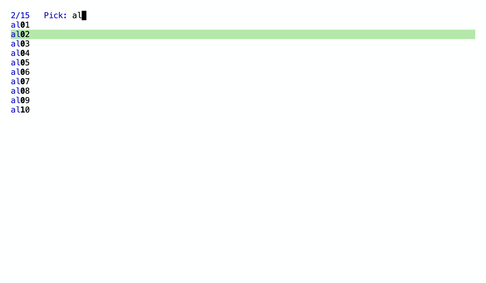

A buffer panel split during the call, with each window's mode line, then with
`:mode-line nil`:

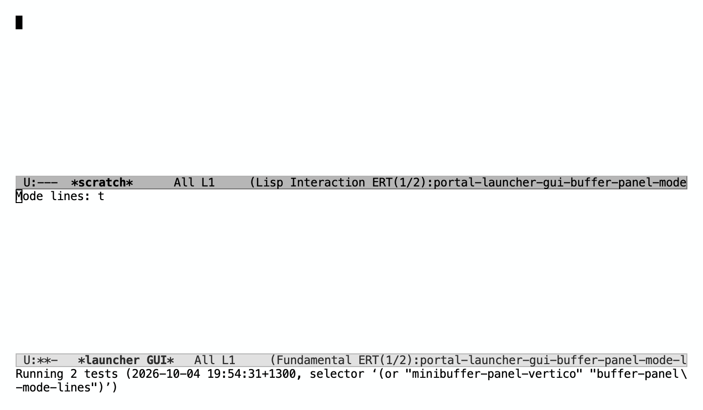

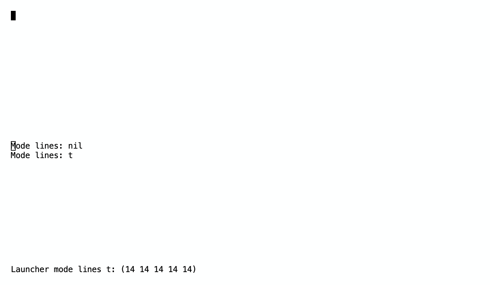

## Content-fitted minibuffer panels

`portal-launcher-size` resolves per presentation, before anything is shown or
an active session is cancelled: nil gives a minibuffer panel `(720 auto)` and a
buffer panel `(720 420)`; `(WIDTH auto)` fits both kinds, a buffer panel only in
a presentation ([content-fitted buffer panels](#content-fitted-buffer-panels));
numeric pairs stay fixed for both kinds. An automatic minibuffer presentation's
session binds `resize-mini-frames` to `portal-launcher--fit` and adds
`portal-launcher--refit` to `post-command-hook`; other presentations bind it to
nil. The binding unwinds
and cleanup removes the hook on every exit path, and the option keeps its value:
no measured height replaces it. There is no timer or polling.

Emacs calls `resize-mini-frames`' function from `resize_mini_window` while it
redisplays a selected, active minibuffer window whose buffer changed, after
the commands, timers and completion UI that changed it (pinned
[xdisp.c](https://github.com/emacs-mirror/emacs/blob/a360712c9d272d950d8d8255ef74570f7e90b7d9/src/xdisp.c),
`redisplay_internal`). That covers typing, Vertico's `post-command-hook`
updates and timer-driven changes without a key press. It can miss a nested
prompt starting or ending: `set_window_buffer` keeps the window's record of the
previous buffer's change count, which can exceed the next buffer's. A command
loop runs `post-command-hook` as each prompt starts, and the command that read
an inner prompt ends with it in the outer one, so the session refits there too.
A GUI regression whose outer prompt changed less than its inner one fails
without that hook.

Measurement uses `window-text-pixel-size` on the panel's minibuffer window at
its current width, with no positions or line options, capped at the display's
height. It follows the display iterator: wrapped input, faces of other heights,
line spacing and end-of-buffer overlay strings count, both Vertico's
before-string and an after-string, and a final newline in either adds no row.
The frame's height minus the window's body height adds internal borders and any
header line once. On NS, Emacs's frame pixels are AppKit points. [Height
limits](#height-limits-and-legal-frame-heights) then bound the measurement, by
default to at least 100 points. An echo-area message temporarily puts its own
buffer in the minibuffer window; fitting skips it, keeping the input's height,
so a long message neither flickers the panel nor leaves it the wrong size.
Messages Emacs shows inline in an active minibuffer are minibuffer content and
fit.

The fit function passes the measured height to the session's bounded request,
described below, which asks the native panel only for a height that differs
from the last one it asked, through `portal_launcher_fit` with the session's
native presentation ID. The platform ignores a stale ID, a hidden panel or an
unchanged rectangle. Otherwise it keeps the placement's screen, left edge, width
and top edge, clamps the bottom edge to that screen's usable area and sets the
panel frame without drawing. It never resolves the pointer's screen, starts a
session, resets recorded focus loss, captures the previous application or
requests key or first-responder status, so IME marked text stays in the same
view. Emacs NS's `resizeWithOldSuperviewSize:` only queues the frame size change
and marks the frame for redisplay: no nested redisplay, which Emacs would
answer by throwing to top level
([nsterm.m](https://github.com/emacs-mirror/emacs/blob/a360712c9d272d950d8d8255ef74570f7e90b7d9/src/nsterm.m)).
The next redisplay draws the same content at the new size, measuring the same
height, so fitting cannot loop. AppKit keeps the layer's contents top-left
while the frame catches up.

The first placement uses the content's height at presentation, before the
function's prompt, which is normally the minimum, centered by the offset and
screen settings; it never opens taller than its content. That rectangle's top
edge is the anchor; later fits move only the bottom edge. A display-arrangement
change places the current height again, possibly on the pointer's screen, and
later fits keep that new top edge. The next presentation resolves screen and
offset afresh.

Graphical tests in a disposable Emacs on 2026-10-05, with Menlo 24 (28-point
lines) and 16-point internal borders, on the displays measured above:

| Content | Native and Emacs frame height |
| --- | --- |
| Prompt and five after-string rows (also five Vertico rows) | 200 |
| Two rows | 116 |
| No rows, or a nested one-line prompt | 100 (minimum) |
| Five rows, line spacing 6 | 236 |
| Five rows, one at face height 1.5 | 213 |
| Vertico with a group title and two candidates | 144 |
| Input wrapped to five lines, no rows | 172 |
| 300 rows, top edge 632 on the LG display | 1115, bottom edge at the usable area's −483 |

Each step kept the native session ID, key status, left and top edges, and the
Emacs frame matched the native height. Vertico gave the same heights with
`vertico-resize` set to `grow-only`, t and nil, and its settings and the
minibuffer resize options were unchanged afterwards. Moving the pointer to the
other display while typing left the panel on its display. A fixed `(720 240)`
control stayed 240 points. Standalone native checks cover the anchored
geometry on negative-origin and offset placements, clamping, stale sessions,
hidden panels, unchanged sessions, responder and focus-loss state, and
display-change reanchoring. Marked text set through Emacs's NS text-input
client stayed through a resize from 200 to 116 points and then committed;
a physical input method and display disconnection were not tested.

Vertico in a fitted panel with five rows, then after typing `alp`, then with no
matches at the minimum:

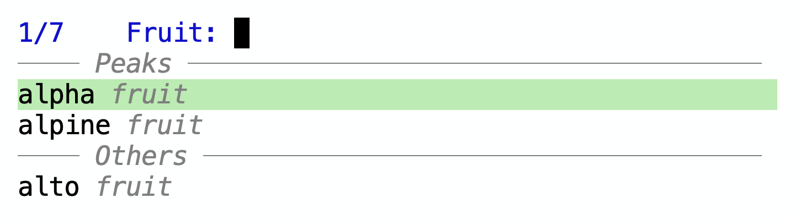

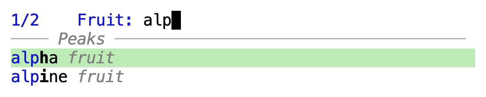


### Height limits and legal frame heights

`portal-launcher-height-limits`, `(MIN MAX)`, is validated with the size before
anything is shown or cancelled: MIN is `content` or a positive fixnum, MAX nil
or a positive fixnum, and a numeric MIN at most MAX. An automatic session keeps
the value it started with, so later bindings and fitting leave both the session
and the option unchanged; a fixed session has no limits.

`portal-launcher--request-height SESSION HEIGHT` is the one resizing path. The
minibuffer and buffer fitters call it. It takes the
session object, never a raw native ID, and does nothing unless that session is
still current, automatic and visible, so a timer from a finished presentation
cannot resize a newer one. It bounds HEIGHT to the larger of the legal height,
a numeric MIN and HEIGHT capped at MAX, skips a height equal to the last one it
asked and calls `portal_launcher_fit`. The first placement bounds its measured
height the same way.

The legal height is `frame-windows-min-size` with IGNORE nil, in pixels, plus
the frame's pixel height minus its inner height (internal borders and any tab
bar), or the frame's `min-height` parameter in lines when that is larger. IGNORE
nil gives each window a line of its text with its tab, header and mode lines,
rounded up to whole lines unless `window-resize-pixelwise`, and at least
`window-min-height` lines; the minibuffer window adds its line, and a
minibuffer-only frame needs only that. Emacs itself lets a frame shrink
further: `resize_frame_windows` falls back to IGNORE t, which ignores
`window-min-height`, as a frame shrinks, and native resizes reach Emacs through
`change_frame_size`, whose `adjust_frame_size` keeps the frame at least
`frame-windows-min-size` with IGNORE `safe` plus borders, which is never larger
([frame.c](https://github.com/emacs-mirror/emacs/blob/a360712c9d272d950d8d8255ef74570f7e90b7d9/src/frame.c),
[window.c](https://github.com/emacs-mirror/emacs/blob/a360712c9d272d950d8d8255ef74570f7e90b7d9/src/window.c)).
But Emacs's Lisp resizing of the minibuffer window, `window--resize-mini-window`
in `window.el`, limits its change by the root window's height minus
`(window-min-size root nil nil t)`, which honors `window-min-height`. With the
root window below that, the limit is negative: every resize, even by zero
lines, gives the minibuffer a negative height and signals `args-out-of-range`.
Completion UIs resize the minibuffer that way: Vertico grows it for its rows in
every normal frame, and the buffer picker prototype, commit `9005099`, hit
this failure at a 100-point panel. A batch test reproduces it. A buffer
panel's floor therefore honors `window-min-height`, 4 lines by default; a
minibuffer panel's is one line either way. A shorter panel would also leave
Emacs's frame taller than its view, cutting off the minibuffer. Portal changes
neither `window-min-height` nor the safe minima; lowering `window-min-height`
gives more compact buffer panels. The C bindings and the platform accept any
positive height: the floor is Lisp policy from Emacs's own window rules, not a
native constant, and numeric `portal-launcher-size` heights still start at
100.

A MAX below the legal height is invalid, and like every other limit error it
is found before a session is cancelled, a panel hidden or a frame replaced.
The legal height depends on the frame's font and parameters, while a
presentation may create or replace its frame, and a second invocation cancels
the active session before presenting anything. A preflight in
`portal-launcher-present` therefore measures, before any of that, the frame
the presentation would show: the dedicated frame when presenting reuses it
unchanged (made for the kind, with no `portal-launcher-font` to apply), or else
a candidate standing in for it. Presenting reuses a live frame of its kind and
only applies the font, so that candidate takes the live frame's own internal
border, `min-height`, horizontal scroll bar and bottom divider parameters,
which may have changed since `portal-launcher-frame-parameters` made it; only
a presentation that makes or replaces the frame is measured with a new frame's
parameters. The candidate stays hidden, unattached and unselected, and is
deleted again; its font is applied without customizing the default face. A
buffer panel's window is measured as it is before the presentation shows its
buffers. If the legal height grows later in a presentation, as with a larger
font, a header line or a split, it wins over MAX rather than cutting off the
prompt. The monitor wins over all: the platform clamps the bottom edge to
the usable area, even below MIN or the legal height.

Graphical tests in a disposable Emacs in the macOS test VM on 2026-10-06, on its
"Apple Virtual" display (usable area `(0, 74, 1326, 742)`, scale 2), with Menlo
24 (28-point lines) and 16-point internal borders. Steps go from five rows of a
minibuffer panel to two, none and five again:

| Limits | First placement | Five rows | Two rows | No rows | Five rows again |
| --- | --- | --- | --- | --- | --- |
| `(100 nil)`, the default | 100 | 200 | 116 | 100 | 200 |
| `(80 nil)` | 80 | 200 | 116 | 80 | 200 |
| `(content nil)` | 60 | 200 | 116 | 60 | 200 |
| `(content 144)` | 60 | 144, clipped | 116 | 60 | 144, clipped |

The legal height of that minibuffer frame was 60 points: one line and both
borders. At 144 points the text measured 168 points in a 112-point body, the
prompt staying at the top. Each step kept the native session ID, key status,
left and top edges and width, and Emacs's frame matched the native height.
Marked text stayed through a resize from 200 to 116 points at `(content nil)`
and committed; the committed text's fallback font then fitted 65 points. With
`portal-launcher-font` set, a `(content 1)` presentation invoked from a live
prompt was measured on a candidate frame and failed, "Launcher maximum height
1 is below the legal height of its panel, 60 points"; the session, prompt, key
status, native rectangle and frame list were unchanged, and the prompt then
completed. With a buffer panel shown, the same call left its frame, window,
buffer, visibility and key status as they were. After the live minibuffer
panel's internal border changed from 16 to 80 points, its legal height with the
launcher font was 188 points, not a new panel's 60: `(content 144)` failed in a
session and outside one, leaving the same state, and `(content 188)` presented
at 188 points.

A buffer panel, a buffer window above its own minibuffer, fitting one line of
content at `(content 300)` with Menlo 13 (15-point lines), opened and stayed at
its legal height: 107 points with Emacs's default `window-min-height`, with or
without the mode line (the window's four lines, the minibuffer's line and both
borders). With `window-min-height` 1 it was 77 points with the mode line (a text
line, the mode line, the minibuffer's line and both borders) and 62 without,
the heights a request for 1 point gave before buffer panels fitted. Emacs's
frame matched, the text line showed, and the minibuffer read input. A hundred
more lines stopped at the 300-point maximum. (Measured 2026-10-07 in the same
VM.) Standalone native checks cover placing and fitting heights below 100
points, including on offset and negative-origin placements, after display
changes, and rejecting zero and negative heights.

A minibuffer panel at `(content 144)`, five rows capped at 144 points, then at
its 60-point legal height with no matches:

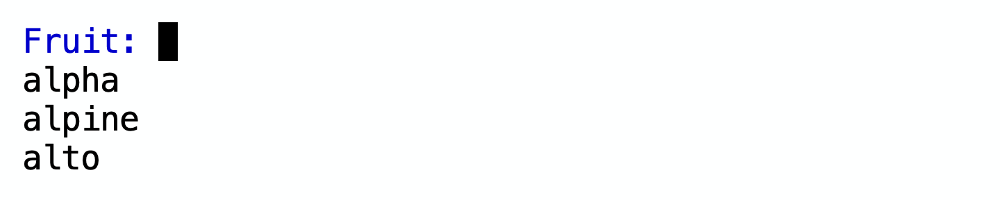


A buffer panel at its legal height, reading a name in its minibuffer: with the
default `window-min-height`, then at 1 with and without the mode line:

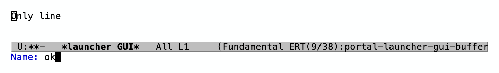

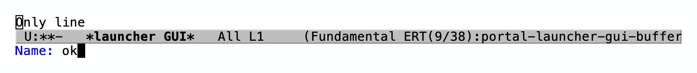


## Content-fitted buffer panels

With `(WIDTH auto)`, a `buffer` presentation fits its frame's ordinary window and
minibuffer through the same session-bound request as minibuffer panels, and the
same anchored native resize. Only a presentation fits: `portal-launcher-show`
outside one refuses an automatic size, since nothing would end the observation.
The session adds `portal-launcher--refit` to `post-command-hook` and, with
`add-function`, `portal-launcher--fit-on-redisplay` after
`pre-redisplay-function`; cleanup removes both on every exit path. It binds
`resize-mini-frames` to nil: in a normal frame Emacs then resizes an active
minibuffer window on every redisplay, as below. There is no timer or polling,
and the code names no completion package, mode or buffer.

`portal-launcher--buffer-height` measures the window with
`window-text-pixel-size` from `point-min` to `point-max`, wherever the window
starts, so scrolling and point never change the height. Its Y-LIMIT is MAX, or
the display's height, so a long chat or log costs at most a full panel's layout
per measurement. The measurement follows the display iterator: wrapped lines,
faces of other heights, line spacing, images, and overlay strings. A final
newline adds the empty line after it, where point can be; otherwise Emacs would
scroll to show a cursor there. The window's mode, header and tab lines, the
minibuffer and the frame's other rows are added, and the window counts at least
`(window-min-size WINDOW nil nil t)`, the least height that the
[legal height](#height-limits-and-legal-frame-heights) keeps for Lisp minibuffer
resizing.

The minibuffer counts as its line, or, while it shows an active minibuffer that
the ordinary window does not also show, as `window-text-pixel-size` of it: the
prompt, the input and an inline completion UI's overlay rows. Emacs's
`resize_frame_windows` gives the minibuffer window exactly one line whenever the
frame's size changes
([window.c](https://github.com/emacs-mirror/emacs/blob/a360712c9d272d950d8d8255ef74570f7e90b7d9/src/window.c)),
then `redisplay_window` grows an active one into the room with
`resize_mini_window`, as `max-mini-window-height` allows
([xdisp.c](https://github.com/emacs-mirror/emacs/blob/a360712c9d272d950d8d8255ef74570f7e90b7d9/src/xdisp.c)).
Counting the minibuffer window's own height instead loops: an echo-area message
grows it, the panel grows, the resize gives it one line again and the panel
shrinks, on every redisplay, as an instrumented graphical run showed. So an echo
message shows as in any frame, within the space Emacs gives it, and never
resizes the panel. Because every resize leaves the minibuffer one line and the
request never drops below the legal height, the ordinary window is at least its
least height after each resize, and Emacs grows the minibuffer only down to it.

Commands are fitted from `post-command-hook`, before Emacs redisplays. NS turns
the native resize into a delayed frame size change, which `redisplay_internal`
applies before laying out windows, so the window never shows a command's changes
at the old size. Timers, process output and echo-area messages change the panel
with no command. Emacs calls `pre-redisplay-function` from `prepare_menu_bars`
at the start of every redisplay, after those changes; the window list it passes
leaves out minibuffer windows, so the panel is measured each time, while it is
visible. That redisplay lays out the old size, then applies the new one and
redisplays again. A window too short for point has scrolled by then, so once all
of the buffer fits, the fitter sets the window's start back to `point-min` with
NOFORCE: point never moves, and a longer buffer keeps its scroll. Measuring
unchanged content gives the height last asked, which asks nothing of the native
panel.

With the root window split, the request is the frame's own height, which the
bounded request still raises to the split layout's legal height; windows are
never deleted or resized by Portal. A numeric resize during the presentation
places a new native session, which `portal-launcher--show` records, and clears
the session's limits, so later requests do nothing.

Graphical tests in a disposable Emacs in the macOS test VM on 2026-10-07, on the
display measured above, with 16-point internal borders and Emacs's default
`window-min-height`, at width 640. Heights are native and Emacs frame heights,
which matched at every step; each step kept the native session, key status, left
and top edges and width, and was fitted before the next key or timer looked:

| Font, limits | Content | Height |
| --- | --- | --- |
| Menlo 24, `(content 400)` | First placement, before content | 172, the legal height |
| | Five lines | 228 |
| | Forty lines | 400, scrollable; window start and point stayed at 1 |
| | Point moved to the end | 400; Emacs scrolled the window |
| | Two lines | 172, the window's four-line least height |
| | Another buffer: header line, two lines, final newline | 200 |
| | The first buffer again | 172 |
| Menlo 24, `(content nil)`, offset 150 down | A hundred lines | 307, bottom at the usable area's |
| Menlo 24, `(content 400)` | Thirty lines from a process, no key pressed | 400; start and point stayed at 1 |
| | A timer cut it to three lines | 200 |
| Menlo 18, `(content nil)`, mode line | A wrapped line | 137, the legal height |
| | Seven lines, one at face height 2.0 | 241 |
| | The same with line spacing 8 | 297 |
| | Six after-string rows added | 367 |
| | Two before-string rows instead | 283 |
| | A header line instead | 262 |

Without the mode line, the same steps gave 137, 220, 276, 346, 262 and 241.
After the presentation, more process output asked nothing of the native panel.
A split of a six-line, 200-point panel raised it to the split's legal height,
221, where three more lines left it; one window again fitted nine lines at 263.
`portal-launcher-resize 600 300` then held at 300 as content grew. The guide's
fitted hello panel, Menlo 18 without a mode line, stayed at its 137-point legal
height for one to four lines and grew to 179 for six.

With Menlo 18, one line of content and `window-min-height` 4, the panel's legal
height is 137 points; at 1 it is 95. A three-line `read-string` prompt grew it to
179 (137); the default `max-mini-window-height` left the minibuffer one line, the
rest going to the buffer window. A one-line inner prompt fitted 137 (95), and the
outer prompt 179 again. With the prompt shown in the buffer window as well and
the minibuffer shrunk to its line, it counted once: 137. Vertico showed five rows
at 242 (200), its minibuffer 126 points tall, and three rows at 200 (158); no
`args-out-of-range` was reported and Vertico's update hook stayed installed.
After the prompt the panel returned to 137 (95). With eight lines of content, a
six-line echo-area message took a second minibuffer line over the buffer's last
line, and the panel stayed at 242.

The panel with five lines, forty capped at 400 points, scrolled to the end, and
shrunk to two lines; then Vertico's three rows in the minibuffer of a compact
panel:

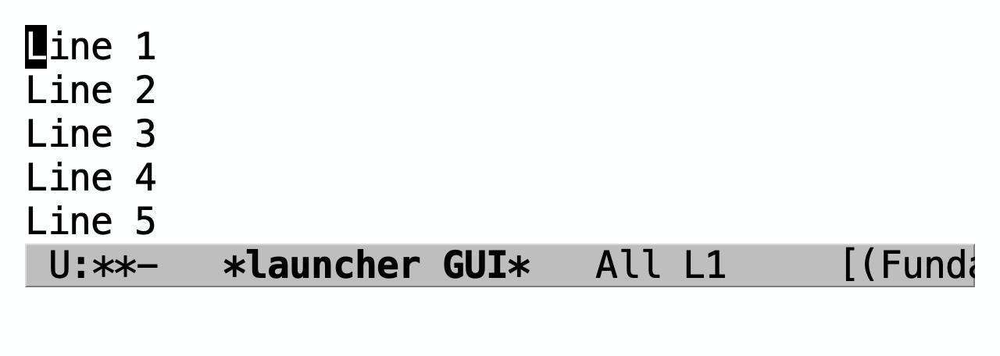

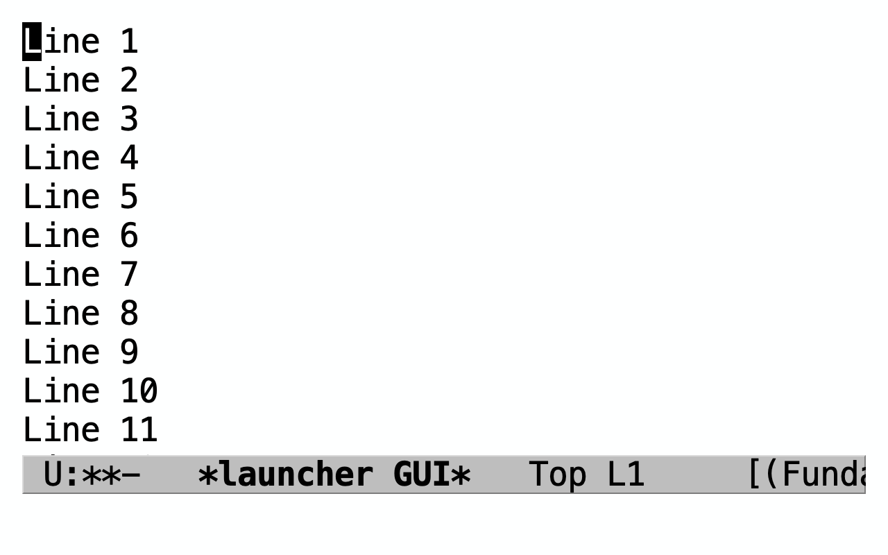

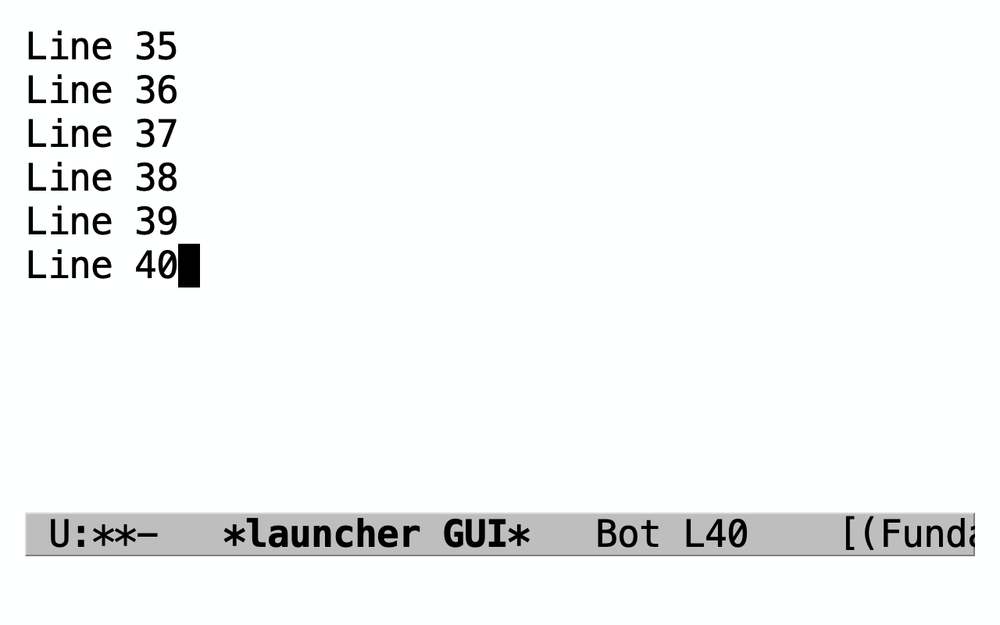

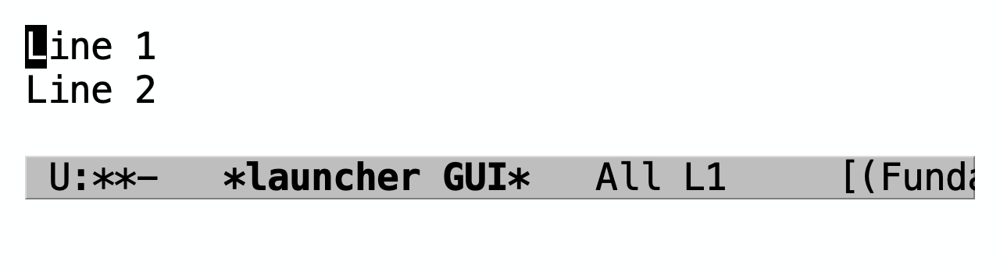

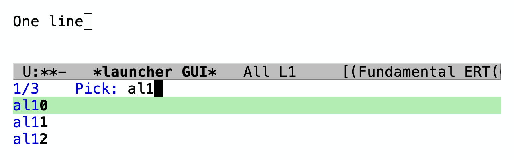

## Persistent buffer panels

With `:keep-open t`, `portal-launcher-present` enters a recursive edit inside
the same catch tag after its function returns. Panel commands retain the
session's emulation keymap, display rules, minibuffer ownership and focus-loss
handling. Their prompts use the panel's minibuffer; cancellation unwinds both
prompts and recursive edit. Every dismissal belongs to the session:
Escape, C-g, `portal-launcher-hide`, `portal-launcher-cancel`, another invocation,
deletion and disable throw to the tag and cancel; focus loss throws `blur`.
`exit-recursive-edit` and `abort-recursive-edit` also cancel. The call returns nil,
discarding the function's value. `top-level` cancels and hides the panel while
also unwinding the caller. Since a minibuffer panel would have nothing left to
use, `:keep-open t` with `:kind 'minibuffer` is rejected before showing.

The recursive command loop reports later command errors and keeps reading,
leaving the panel usable. Reporting exits batch Emacs, so batch tests replace
`command-error-function`. Cleanup still hides the panel, deletes call-created
windows and kills no buffers. Pre-existing windows retain their last buffers
until the next presentation shows `*Portal Launcher*` in the selected window.

While a persistent panel is open, `%[` in the default `mode-line-modes` brackets
the mode name in every frame, reflecting the recursive edit. Ending a keyboard
macro also ends a recursive edit; batch tests rely on this to avoid waiting for
input.

A persistent hello-world panel with `:mode-line nil`, after its local `n`
command read a name from the panel's minibuffer:


